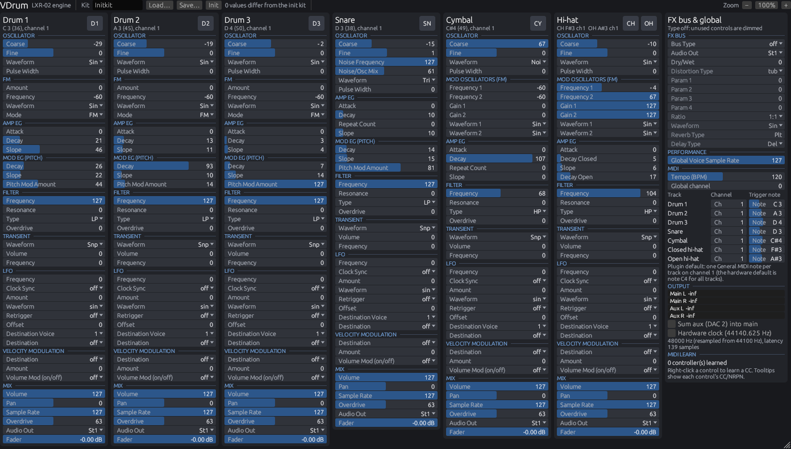

# VDrum

A Rust port of the sound engine of the Erica Synths LXR-02 drum machine firmware (v1.71), as a standalone
application and CLAP / VST3 / AU plugin. Unofficial; not affiliated with or endorsed by Erica Synths.
Based on the GPL-3.0 LXR firmware source (https://github.com/erica-synths/lxr-desktop-app); this project is
licensed GPL-3.0-only.



* The engine (`crates/lxr-core`) reproduces the firmware's 16-bit output byte for byte, as verified against
  the shipped v1.71 firmware running in an emulator. Scope and limits: [docs/VERIFICATION.md](docs/VERIFICATION.md).
* All sound parameters of the kit are exposed as host parameters, can be MIDI-learned, and respond to the
  firmware's own CC/NRPN mapping.

## Build

```sh
cargo xtask bundle vdrum --release   # target/bundled/VDrum.clap, VDrum.vst3, VDrum (standalone)
```

macOS universal: `cargo xtask bundle-universal vdrum --release`; AU and macOS app: see `au/CMakeLists.txt`.
Linux needs the X11/GL/ALSA/JACK development packages listed in `.github/workflows/ci.yml`.
Details: [plugin/README.md](plugin/README.md).

## Verify

```sh
# reference firmware build (Arm GNU Toolchain 11.3.rel1)
tools/build_fw.sh "$PWD/third_party/lxr-firmware" "$PWD/out/fw" <toolchain>/bin/arm-none-eabi-   # absolute paths
LXR_FW_ELF=$PWD/out/fw/fw.elf LXR_FIRMWARE_IMG=/path/to/LXRV2_update_v1.71.img \
  cargo test --workspace --release
```

## Layout

| Path | Purpose |
|---|---|
| `crates/lxr-core` | the engine (port of `Core/Src/Soundengine/**` and the MIDI/kit/sequencer code it needs) |
| `crates/lxr-emu` | Cortex-M7 emulator running the firmware; scenario renderer (`lxr-emu` CLI) |
| `crates/lxr-difftest` | differential tests, engine vs. emulated firmware |
| `crates/lxr-params` | parameter metadata (names, ranges, display text, MIDI mapping) |
| `plugin/` | nih-plug plugin and GUI |
| `tests/scenarios/` | scenario corpus and v1.71 reference hashes |
| `docs/` | [architecture](docs/ARCHITECTURE.md), [engine contract](docs/ENGINE_CONTRACT.md), [porting status](docs/PORTING_STATUS.md), [verification](docs/VERIFICATION.md) |
