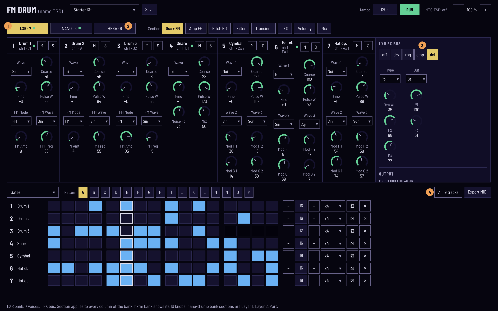
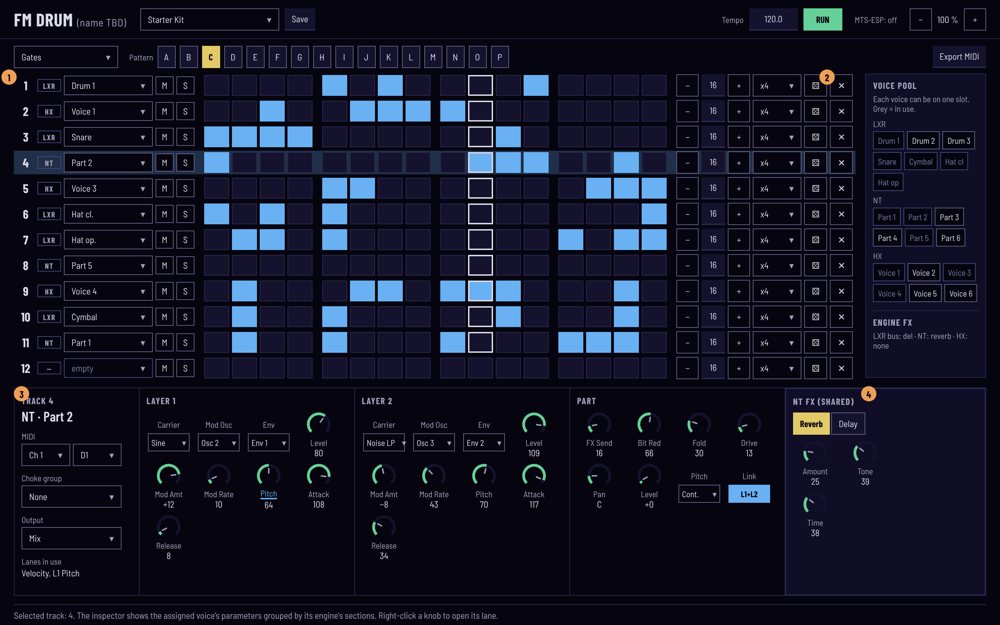
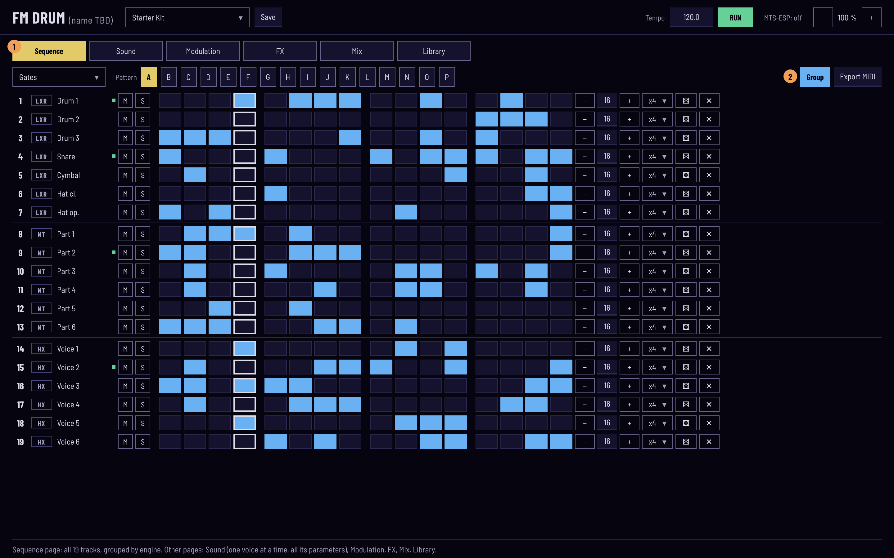
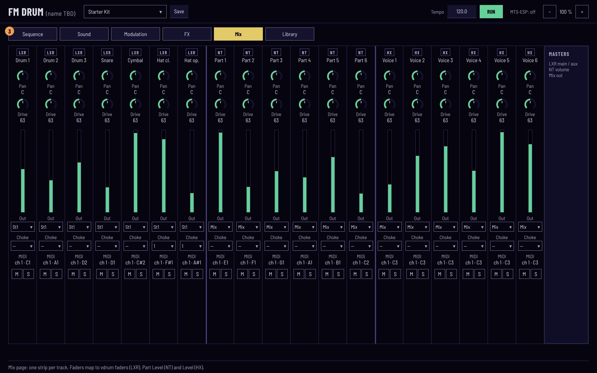

# Consolidation of VDrum, Hexa FM Drum and nano-thump: review

Status: draft, 2026-11-25. Covers the feature inventory, the conflicts, the open questions and three
UX proposals. The implementation plan follows in `implementation-plan.md`, after the questions in
section 4 are answered and one proposal is chosen.

Sources (default branches, 2026-11-25):

| Repository | Commit | Product name in code |
|---|---|---|
| `sazl/vdrum` | `7f1471f` | VDrum |
| `sazl/hxfmdrum` | `99484b5` | Hexa FM Drum (`hexa_fm_drum`) |
| `sazl/nano-thump` | `4884c6b` | nano-thump (`nt-plugin`) |

Requirements, as given by Sami on 2026-11-25:

* overall style, design and UI of hxfmdrum;
* the sequencer of hxfmdrum;
* all drum voices, parameters, effects and modulation of all three;
* all other features of all three;
* one consistent UX;
* a plan that guarantees the result is a superset of the three feature sets.

## 1. Feature inventory

### 1.1 Overview

| | VDrum | Hexa FM Drum | nano-thump |
|---|---|---|---|
| Origin | Port of the Erica Synths LXR-02 firmware v1.71 sound engine | Clean-room implementation from a third-party manual | Reimplementation of the nano-thump device firmware |
| Exactness | Bit-exact against the shipped firmware (emulator, 299 scenarios) | n/a | Bit-exact against the firmware in an emulator (`audiocheck`) |
| Engine rate | 44100 Hz (optional 44140.625 Hz "hardware clock"), 64-frame ticks, i16 | Host rate, f32, sub-blocks of at most 64 samples | 48000 Hz, 64-frame blocks, i24; voices at 24 kHz |
| Resampling | rubato sinc when host rate ≠ 44100 | none needed | 4-point cubic Hermite when host rate ≠ 48000 |
| Framework | nih-plug `de421011`, vendored `nih_plug_egui` and `egui-baseview` | nice-plug 0.4.2, nice-plug-egui 0.6.0, egui 0.37 | nih-plug `de421011`, vendored `nih_plug_egui` |
| Rust | edition 2021 | edition 2024, Rust 1.88+ | edition 2021 |
| Formats | CLAP, VST3, standalone, AUv2 + macOS app (clap-wrapper) | CLAP, VST3, standalone, AUv2 (clap-wrapper) | CLAP, VST3, standalone |
| Licence | GPL-3.0-only | none stated in the repository | MIT stated; tables and kits extracted from the firmware at build time (`NT_FIRMWARE`) |
| CI / release | `ci.yml`, `release.yml` (Linux, Windows, macOS, AU) | none | `macos-app.yml` (needs `NT_FIRMWARE_B64` secret) |

### 1.2 Voices

**VDrum (LXR-02).** 7 voices: Drum 1, Drum 2, Drum 3, Snare, Cymbal, closed Hi-hat, open Hi-hat
(the open hat is a VDrum extension, `lxr_core::vdrum::open_hat`). 36–37 parameters per voice.

| Section | Drum 1–3 | Snare | Cymbal | Hi-hat (closed, open) |
|---|---|---|---|---|
| Oscillator | Waveform (Sin, Tri, Saw, Rec, Noise, PWM), Coarse, Fine, Pulse Width | same + Noise Frequency, Noise/Osc Mix | Waveform 1–3, Coarse, Fine, Pulse Width | same as Cymbal |
| FM / mod osc | FM Mode (FM/Mix), FM Waveform, FM Amount, FM Frequency | – | Mod Osc Frequency 1/2, Gain 1/2 | same as Cymbal |
| Amp EG | Attack, Decay, Slope | Attack, Decay, Slope, Repeat Count | Attack, Decay, Slope, Repeat Count | Attack, Decay Closed, Decay Open, Slope |
| Pitch / Mod EG | Mod EG Decay, Pitch Mod Amount, Modulation Slope | same | – | – |
| Filter | Type (LP, HP, BP, UBP, Notch, Peak, LP2, off), Frequency, Resonance, Filter Overdrive | same | same | same |
| Transient | Waveform (14: Snp, Ofs, Clk, Ck2, Tik, Kik, Rim, Drp, Hat, Clp, Kk2, Snr, Tom, Sp2), Volume, Frequency | same | same | same |
| LFO (one per voice) | Waveform (8), Frequency, Clock Sync (12 rates), Amount, Offset, Retrigger (off, v1–v6), Destination Voice, Destination (229 targets) | same | same | same |
| Velocity mod | Velocity Amount, Destination (229 targets), Velocity Volume Mod on/off | same | same | same |
| Mix | Volume, Pan, Overdrive, Sample Rate (decimation), Audio Out (St1, St2, L1, R1, L2, R2, FX) | same | same | same |
| Plugin extras | fader 0–99 per voice (hardware ADC path) | | | `hat_choke` (closed hit chokes the open hat); the open hat has its own 37 parameters, LFO and velocity mod (targets 229–254) |

Global sound parameters: Global Voice Sample Rate, Global Tempo (LFO sync without host tempo).

**Hexa FM Drum.** 6 identical voices, each with two operators.

| Parameter | Range / values |
|---|---|
| Level | 0–100 % |
| Pan | L–R |
| Start, End | 20 Hz – 3 kHz, default 150 Hz |
| Speed | 0–100 % (pitch glide Start → End; 0 = no glide) |
| Ratio | 1:2, 1:1, 2:1 … 8:1 |
| Wave | Sine, Triangle, Saw, Square, Pulse, Half Sine, Abs Sine, Fold (both operators) |
| Feedback | 0–100 % (op 1 self-feedback) |
| Release 1, Release 2 | 5 ms – 2 s (per operator) |
| Algorithm | FM (op 1 → op 2) or Mix |
| Mute, Solo | per voice |

**nano-thump.** 6 parts, each with 2 layers (12 voices). 21 parameters per part.

| Group | Parameters |
|---|---|
| Layer 1 and Layer 2 (7 each) | Type (select code: carrier 0–4 = sine, wavetable, noise HP/LP/BP; modulator oscillator 0–2; envelope type 0–2; 45 valid codes), Level, Mod Amount (signed), Mod Rate, Pitch, Attack, Release |
| Part (7) | FX Send, Bit Reduction, Fold, Drive, Pan, Level, Pitch Mode (Continuous / Semitones) |
| Velocity | MIDI velocity, 5-bit, scales layer level |

### 1.3 Effects

| VDrum | Hexa FM Drum | nano-thump |
|---|---|---|
| Per voice: filter with overdrive, voice overdrive, sample-rate decimation, transient generator | none | Per part: bit reduction, wave folding, drive |
| FX bus: type off / drive (tube, fold, clip) / ring mod (6 waves) / compressor (ratio 1:1–8:1) / delay (Delay, Ping-pong); Dry/Wet; P1–P4 per type; output routing St1–R2 (the firmware reverb is compiled out, `USE_REVERB = 0`) | | Send FX: reverb or tempo-synced delay; Amount, Tone, Time |
| Mixer: two stereo DACs; "Sum aux into main" | | Fixed output stage: chorus-like stage, soft clip, compressor, master volume (0–255) |

### 1.4 Modulation

| VDrum | Hexa FM Drum | nano-thump |
|---|---|---|
| 7 LFOs (one per voice), 8 waves, free or clock-synced, retrigger by voice, cross-voice targets | none (no LFO, no envelope modulation beyond the voice's own glide and releases) | per-layer modulator oscillator (Mod Rate, Mod Amount) phase-modulating the carrier |
| Velocity modulation per voice to any target; velocity to volume | MIDI note sets pitch (Start; End follows) | velocity to level |
| Mod EG (pitch) on Drum 1–3, Snare | Start→End glide (Speed) | envelope type per layer |
| | **Per-step modulation lanes** for all 10 voice parameters (value = knob + step × (1 − knob)) | |

### 1.5 Sequencer

| VDrum | Hexa FM Drum | nano-thump |
|---|---|---|
| none (removed 2026-11-14; MIDI clock and transport ignored) | 6 tracks × 16 steps; length 1–16 per track (default 8); speed per track (/2, x1, x1 d, x2, x2 d, x3, x4, x4 d, x6, x8, x12); lanes: Gates, Delay (micro-timing), 10 parameter lanes, Random Skip; dice (randomize) and clear per track and view; 16 patterns A–P with copy/paste/clear; `Selected Pattern` host parameter; host transport or standalone internal clock (Run, Tempo 40–300); MIDI export (.mid, per pattern or per track) | none (device sequencer not modelled); 16 patterns exist only as kit number + mute mask + choke mask |

### 1.6 MIDI

| VDrum | Hexa FM Drum | nano-thump |
|---|---|---|
| Channel and note per track (default ch 1, GM notes 36, 45, 50, 38, 49, 42, 46); global channel | Voice n on channel n (1–6); note sets pitch; pitch bend ±2 semitones; MTS-ESP microtuning | Part n on channel n (configurable 1–16 or off per part); notes trigger regardless of note number (unless global channel mode: notes 60–69 map to parts) |
| Firmware CC/NRPN map disabled; MIDI learn for every parameter (right-click), saved in state | no CC handling | Firmware CC map (per-part or global layout, layer link); program change selects pattern + kit |
| Program change ignored | | |

### 1.7 Presets, kits and state

| VDrum | Hexa FM Drum | nano-thump |
|---|---|---|
| `.snd` kit load/save (LXR-02 format + `VDX1` open-hat block); Init kit; 64-slot kit library in plugin state; import `.snd` files and LXR-02 project folders; export LXR-02 project folder; ◀ ▶ browse | JSON presets (all voices + 16 patterns); factory presets Starter Kit, Polymeter Study, Clonk Machine, Noise Garden, Blank Slate; user presets in a folder; per-voice copy/paste/reset | 16 factory kits/patterns from the firmware, or Init store; Program parameter 1–16; Kit source (Factory/Init) |

### 1.8 Other features

| VDrum | Hexa FM Drum | nano-thump |
|---|---|---|
| OSC 1.0 + OSCQuery server (mDNS), addresses for parameters, faders, switches, MIDI, kit browse, transport, LFO outputs, mutes | Multi-output: Mix + 6 stereo voice outputs, or Mix only | Pads per part with trigger flash |
| Outputs: main + aux (DAC 2), Sum aux switch, Main-only layout | Standalone clock | Output peak meter |
| Hardware clock switch (44140.625 Hz) | Status line | Host tempo switch for the delay; Tempo 10–600 BPM |
| Editor: one card per voice, all parameters on one screen, changed-value stripe and count, tooltips with ID and learned CC, zoom 50–300 %, resizable, meters | Editor: Prism design tokens, Barlow fonts, voice columns with 10 knobs, sequencer below, right-click knob opens its lane, right-click voice/track/pattern menus | Editor: colour-coded part columns, redraws only on change |
| Pads with trigger lights; OSC panic | Hit indicators | App icon |
| Engine fault safety net; FTZ/DAZ guard; no allocation on audio thread (checked) | | FTZ check example, bench |
| Verification crates: `lxr-emu`, `lxr-difftest`, scenario corpus | `render_demo` example | `nt-emu`, `nt-syro`, `audiocheck` |

## 2. Conflicts

| # | Area | Conflict | Proposed resolution (subject to section 4) |
|---|---|---|---|
| C1 | Framework | hxfmdrum uses nice-plug 0.4.2 / egui 0.37; vdrum and nano-thump use nih-plug `de421011` with vendored older egui adapters carrying zoom/resize/redraw fixes. | Use nice-plug (hxfm style and its `RepaintNotifier`); port vdrum's zoom/resize fixes and nano-thump's redraw-on-change to nice-plug-egui if still needed. |
| C2 | Licence | LXR port is GPL-3.0-only, so the combined product is GPL-3.0-only. nano-thump is stated MIT but its build embeds tables and factory kits extracted from proprietary firmware. hxfmdrum has no licence file. | Combined repository GPL-3.0-only; hxfmdrum and nano-thump code relicensed (Sami is the author); nano-thump engine behind a build feature (Q3). |
| C3 | Engine rates and timing | 44.1 kHz/64 (LXR), 48 kHz/64 (NT), host rate (HX). Sequencer hits are sample-accurate for HX but quantised to engine ticks for LXR and NT. Latency differs per engine. | Run both firmware engines in their own rate and resample; report the larger latency and delay the other paths to align; quantisation stays (Q9). |
| C4 | Number of tracks | Sequencer is 6 tracks; voices total 19. | Track model per Q5; the three proposals differ here. |
| C5 | Monolithic engines | LXR voices share one FX bus, cross-voice LFO targets and mixer; NT parts share FX, compressor and choke mask. A voice cannot be duplicated or detached from its engine. | Each engine is one instance; voices map 1:1 to tracks or slots. |
| C6 | Lanes vs parameter count | HX lanes cover 10 parameters; LXR voices have ~37, NT parts 21. A lane dropdown with ~40 entries is unwieldy. | Lanes created on demand (right-click a knob); dropdown lists lanes in use (Q7). |
| C7 | Lanes on firmware engines | Lane values must be written into the firmware engines per hit through their parameter paths, which can change engine state (e.g. LXR `set_parameter` recalculates coefficients). Writing every lane every step costs CPU and differs from hardware behaviour. | Write only lanes in use, only when the value changes, at the tick the hit falls on; restore the knob value when the lane is 0 (HX semantics: knob = minimum). |
| C8 | Lane value scale | HX lanes are 0..1 added towards the maximum. LXR/NT parameters are integer bytes, some signed (pan, NT Mod Amount), some lists (waveforms, filter type, targets). | Same formula on the normalized value, rounded to the parameter's steps; list parameters step through their entries. |
| C9 | Velocity | HX sequencer triggers at full level; LXR velocity modulation and NT velocity need a velocity value. | Add a Velocity lane (Q8). |
| C10 | MIDI channels | HX: voice n = channel n (1–6). NT: part n = channel n (1–6). LXR: all on channel 1 with notes. Channels 1–6 collide. | Per-track channel + note for every track (Q12). |
| C11 | MIDI note meaning | HX: note sets pitch. LXR, NT: note only selects the voice. | Per-track "note sets pitch" (HX only by default). |
| C12 | CC / program change | NT uses its firmware CC map and program change; vdrum deliberately drops CCs except learned ones; HX ignores CCs. | Firmware CC maps off by default with an option per engine; MIDI learn for all; program change selects pattern (Q12). |
| C13 | Pattern concept | HX pattern = sequence data (A–P). NT pattern = kit number + mute + choke. vdrum has kits only (64-slot library). | Pattern = sequence (+ optional mute state); kit/sound = preset; NT mute/choke masks become track mutes and choke groups (Q11, Q14). |
| C14 | Mute / solo / choke | HX mute/solo parameters; NT mute mask; LXR track mutes (`seq_setMute`, NRPN `CC2_MUTE_*`); vdrum hat choke; NT choke group mask. | One mute/solo per track; choke groups over all tracks (Q11). |
| C15 | Outputs | HX: Mix + 6 stereo. vdrum: main + aux with per-voice routing St1/St2/L1/R1/L2/R2/FX. NT: stereo only. | Mix + N stereo aux; per-track output selector; LXR routing mapped onto it (Q13). |
| C16 | Tempo | HX standalone Run + Tempo (40–300). vdrum Global Tempo (LXR parameter, 0–255). NT Tempo (10–600) + Host tempo switch. | One tempo source: host, else the standalone tempo; it drives all three (LXR `set_tempo`, NT `set_tempo`). Range 10–300. |
| C17 | Levels | LXR voice volume + fader (0–99, ADC path); HX Level; NT part level, layer levels and master volume 0–255. | Keep all; the Mix view shows one primary fader per track (LXR fader, NT Part Level, HX Level). |
| C18 | Pan / drive naming | "Drive" exists as LXR Voice Overdrive, LXR Filter Overdrive, LXR FX drive, NT Drive. Pan ranges differ. | Labels prefixed by section in the UI ("Filter Drive", "Voice Drive"); host parameter IDs prefixed by engine. |
| C19 | Presets / file formats | LXR `.snd`/projects, HX JSON, NT firmware kits. | One preset format (JSON: all tracks + patterns + engine kit blobs); import of all three. |
| C20 | Host parameter IDs and plugin IDs | Three plugins with different CLAP/VST3/AU IDs and parameter IDs; old DAW projects reference them. | New plugin IDs, parameter IDs prefixed `lxr_`, `nt_`, `hx_` (Q2). |
| C21 | Window size | HX 1200 × 900 fixed; vdrum 1584 × 790 resizable with zoom; NT own size. | HX style, resizable, zoom (Q15). |
| C22 | Colour use | NT colours each part; Prism gives each accent one job (blue = selection, green = primary/fill, yellow = single choice, amber = warning, red = destructive). | Follow Prism; engines are identified by a text tag (LXR, NT, HX) and grouping, not by colour. vdrum's amber "changed value" stripe conflicts with amber = warning; use a muted marker instead. |
| C23 | Build inputs | NT needs `NT_FIRMWARE` to build; LXR differential tests need `LXR_FW_ELF`/`LXR_FIRMWARE_IMG` (tests skip without). | NT behind a cargo feature; CI builds without it unless the secret is set (Q3). |
| C24 | Random numbers | HX random skip uses a time-seeded RNG; LXR uses a deterministic xorshift for its own noise. | Keep separate RNGs; random skip must not consume the LXR RNG. |

## 3. UX proposals

All three use hxfmdrum's Prism tokens, Barlow fonts, top bar, knobs, square buttons and its
sequencer (view dropdown, A–P pattern bank, Export MIDI, per-track length −/+, speed, dice, clear,
right-click a knob to open its lane). They differ in how the 19 voices are organised. The mockups
use placeholder values and the placeholder name "FM DRUM"; numbered circles mark the points below.
They were generated by `mockups/gen_mockups.py`.

### 3.1 Proposal A: engine banks

1. Bank selector: LXR (7), NANO (6), HEXA (6). Hit lights per bank.
2. Section selector for the bank (LXR: Osc + FM, Amp EG, Pitch EG, Filter, Transient, LFO,
   Velocity, Mix; NANO: Layer 1, Layer 2, Part; HEXA: one page with its 10 knobs). Every column
   shows the same section, so the layout is hxfm's: one column per voice, up to 10 knobs.
3. The bank's own FX panel (LXR FX bus; NANO reverb/delay; HEXA none) and outputs.
4. The sequencer shows the bank's tracks; "All 19 tracks" shows every track in compact rows.

* Track model: 19 fixed tracks (Q5 a).
* Closest to each original machine; little new interaction to learn.
* Comparing or editing voices from different engines needs bank switches.

### 3.2 Proposal B: track slots with inspector

1. 12 track slots. Each slot is assigned one voice from the pool (dropdown); an engine tag shows
   where the voice comes from.
2. Voice pool: the 19 voices; a voice can be on one slot at a time (engine constraint C5).
3. Inspector for the selected track: track settings (MIDI channel and note, choke group, output,
   lanes in use), then the voice's parameter groups (here a nano-thump part: Layer 1, Layer 2,
   Part, with the layer link switch).
4. The shared FX of the selected voice's engine.

* Track model: slots (Q5 b). 12 is a proposal; 16 would also fit with smaller rows.
* Sequencer-first, like a groovebox; a kit can mix engines freely (e.g. LXR kick, HX toms, NT
  hats) in any order.
* Needs slot assignment, which none of the three has today. Unassigned voices still exist in their
  engines but are not sequenced.

### 3.3 Proposal C: function pages

1. Page tabs: Sequence, Sound, Modulation, FX, Mix, Library.
2. Sequence: all 19 tracks in compact rows, grouped by engine ("Group" toggle sorts by engine or
   by a user order).
3. Mix: one strip per track (engine tag, name, pan, drive, primary fader, output, choke group,
   MIDI, mute/solo) and the engine masters.

Not drawn: Sound (voice selector strip, then every parameter of one voice, as vdrum's card),
Modulation (LXR LFO and velocity tables for all 7 voices, NT mod rate/amount, lane overview),
FX (LXR FX bus, NT FX and output stage), Library (presets, kit library, imports, exports).

* Track model: 19 fixed tracks (Q5 a).
* Each page has one job; global tasks (mixing, routing, modulation overview) are on one screen.
* Sound editing and sequencing are on different pages, unlike hxfmdrum, where both are visible.

### 3.4 Comparison

| | A: banks | B: slots + inspector | C: pages |
|---|---|---|---|
| Tracks in sequencer | 6–7 (19 compact) | 12 (assignable) | 19 |
| Sound and sequence on one screen | yes | yes (one voice) | no |
| Closeness to hxfmdrum layout | highest | medium | medium |
| New concepts | bank, section | slot, voice pool | pages |
| Cross-engine overview | low | medium | high |
| Implementation size (rough estimate, relative) | 1 | 1.3 | 1.2 |

## 4. Open questions

Asked in the project thread on 2026-11-25. The answers decide the plan.

1. Target repository (default: vdrum).
2. Product name and plugin IDs (default: new IDs; import old kit/preset files, not DAW state).
3. nano-thump firmware data in release binaries (default: build feature, off without `NT_FIRMWARE`).
4. Removed vdrum features: sequencer, Perform, Morph/Macro, LCXL3, Move (default: excluded).
5. Track model: 19 fixed tracks or assignable slots (default: 19 fixed).
6. Sequencer size: 16 steps, 16 patterns for every track (default: yes).
7. Lanes for all parameters, created on demand (default: yes).
8. Velocity lane (default: add).
9. Bit-exactness of the LXR and NT engines kept (default: yes).
10. Cross-engine modulation and FX routing (default: none).
11. Choke groups over all tracks, mute/solo on all tracks (default: yes).
12. MIDI mapping: channel + note per track, note-sets-pitch per track, firmware CC maps off, MIDI
    learn, program change selects pattern (default: as listed).
13. Outputs: Mix + 8 stereo aux with per-track selector (default) or Mix + 19 stereo.
14. Presets: one preset with all sounds and patterns; vdrum kit library and LXR-02 project I/O
    kept for LXR voices; NT factory/init kits kept (default: yes).
15. Window: Prism style, resizable, zoom 50–300 % (default: yes).
