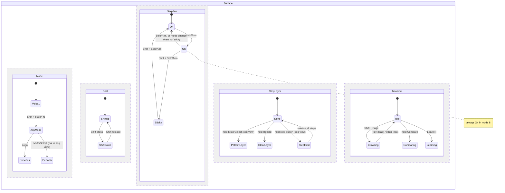

# Brainstorm: declarative LCXL3 modes, surface and state machine

Status: brainstorm, 2026-11-06. No code. Sections 1 to 5 are the original survey; section 6 is the
direction after Sami's answers. Remaining open questions are in 6.6.

## Decisions (Sami, 2026-11-06)

1. Iterate both in a simulator and on the hardware; the on-screen simulator is the main tool.
2. A live state diagram generated from the spec is enough for now (no editing in the diagram).
3. Authoring language: Python.
4. Simulator platform: the browser.
5. Browsers: Chrome and Firefox. Browser support is not a constraint (Firefox needs the Web MIDI
   site permission add-on for the device route).
6. Migration reproduces today's behaviour exactly (strict parity) before anything changes.

Goal (Sami, 2026-11-06): define the modes, the controls and the mode/state machine of the Launch
Control XL 3 surface declaratively, so that the workflow can be iterated on quickly, with tooling
to map, visualize and test modes and components visually, and to view and edit the state diagram.

## 1. Current state (checked on main, b170272)

| Concern | Where it lives | Form |
|---|---|---|
| Mapping tables for images and docs | `docs/lcxl3-daw-mode/source/layout.py` (384 lines) | Python dicts built by functions (`voice_common`, `drum_mode`, ...). Entry = `(label, detail, section, kind)` |
| Images | `docs/lcxl3-daw-mode/source/render.py` | Pillow, draws boxes over a photo of the device, fixed pixel coordinates |
| Runtime mapping | `crates/vdrum-surface/src/layout.rs` (706 lines) | Rust builder functions that mirror `layout.py` by hand. `Cell { label, section, binding }` |
| Behaviour of each binding | `crates/vdrum-surface/src/surface/mod.rs` (1594 lines), `perform.rs` | `match cell.binding` in `encoder`, `fader`, `press`, `release`, `hold_fired`, `led`, `range_of` |
| Mode and layer state | fields of `Surface` | `mode`, `prev_mode`, `shift`, `view`, `sticky`, `held_steps`, `held` (Mute/Select pattern layer, Record clear layer), `accent`, `browsing`, `comparing`, `learning`, `moments` |
| Precedence between layers | order of the arms in `Surface::button` | implicit |
| On-screen view of the surface | `surface/view.rs` (`View`, `layers()`) and the egui editor's mode tabs | the editor draws a `View` and sends mouse input back through `Surface::handle_editor` |
| Tests | `crates/vdrum-surface/tests/surface.rs` (59 functions) | a `Fake` model, input sequences, assertions on actions and LEDs |

Observations:

1. There are two hand-synchronised sources for the mapping (`layout.py` and `layout.rs`). Nothing
   checks that they agree. Overlays such as the sequencer view in other modes exist in Rust
   (`Layout::with_steps`) but `layout.py` can only describe them as text on the side buttons,
   because it has one flat table per mode and no layers.
2. The state machine is not written down anywhere as a machine. It is spread across ~12 fields and
   the order of `match` arms. Drawing it requires reading the code.
3. A simulator already half exists: `Surface` has no I/O, the plugin editor renders `View` and
   routes mouse edits into it, and the tests drive it with a fake `Model`.
4. The behaviour vocabulary is closed: `Binding` has about 60 variants. New behaviour needs Rust.

The implicit machine, reconstructed from `Surface::button`, `set_mode`, `relayout` and
`layers()` (my reading; not generated):



## 2. Proposed end state

One declarative spec is the single source for the runtime, the images, the tables, the state
diagram and the simulator. Rust provides a fixed catalogue of behaviour primitives; the spec
composes them.

```
                    ┌──────────────── surface spec (files in repo) ───────────────┐
                    │ hardware  sections  templates  modes  layers  statechart    │
                    │ led rules  screen rules  scenarios (tests)                  │
                    └──────────────┬──────────────────────────────────────────────┘
                                   │ parse + validate (schema, param ids, reachability)
                                   ▼
                          compiled spec (JSON IR)
           ┌───────────────┬───────┴────────┬─────────────────┬────────────────┐
           ▼               ▼                ▼                 ▼                ▼
   vdrum-surface      renderer          diagram          simulator        scenario runner
   interpreter        (SVG/PNG,         (Mermaid /       (virtual LCXL3,  (cargo test,
   (plugin, hot       tables .md)       ELK, editable)   live state,      replay in the
   reload)                                               action log)      simulator)
```

### 2.1 Layers of the spec

| Layer | Content | Declarative? |
|---|---|---|
| Hardware | the controls of one LCXL3 (24 encoders, 8 faders, 16 buttons, side buttons), their DAW-mode CCs, their drawing geometry | yes, fixed data; also the place to declare 2 to 3 units (see `lcxl3-multi-unit/brainstorm.md`) |
| Vocabulary | tracks, colours, sections, parameter-id templates (`vid` in `layout.py`, `voice_param` in Rust) | yes |
| Templates | reusable blocks (`voice_common`, `lfo_row`, `pads`, `steps`) with parameters, and "for each track" | yes, needs a small template mechanism |
| Modes | a base layout per mode: control → binding, label, section | yes |
| Layers / overlays | partial layouts that replace controls while a state is active (Shift, sequencer view, step held, pattern layer, clear layer) with an explicit priority | yes |
| Statechart | parallel regions, states, events (`press(SHIFT)`, `release(B3)`, `hold(T4, 1000ms)`, `mode_changed`), guards, transitions, entry/exit actions | yes |
| Behaviour primitives | `param`, `cycle_param`, `toggle_param`, `trigger`, `mute`, `seq_step`, `moment`, `macro`, `snapshot`, `kit_browse`, ... with arguments | catalogue in Rust; the spec only references them |
| LED and screen rules | LED style per binding (`value_brightness`, `on_off`, `lfo`, `pulse`, `track_colour`), popup text templates | mostly yes, as a fixed set of named styles plus arguments; a free expression language is possible but not recommended at first |
| Scenarios | input scripts with expected state, actions, LEDs | yes |

### 2.2 What the spec could look like

Illustrative only; format not chosen (see 3.1). YAML used here because it is short to read.

```yaml
templates:
  voice_common(v):
    T1:  { label: Osc wave,  section: OSC,    do: cycle_param(vid(v, wave)) }
    K11: { label: Fine,      section: OSC,    do: param(vid(v, fine)) }
    F1:  { label: Coarse,    section: OSC,    do: param(vid(v, coarse)) }
    T2:  { label: Copy voice, section: EDIT,  do: copy_voice }
    T3:  { label: Paste voice, section: EDIT, do: hold(1000ms, paste_voice) }
    # ...
    use: [lfo_row(v), pads]

modes:
  drum-1: { slot: 1, columns: drum, use: [voice_common(1), drum_extras(1)] }
  sequencer:
    slot: 8
    for track in tracks:
      "K1{track.col}": { label: "{track} Fills", section: SEQ_T, do: seq_fills(track) }
    use: [steps]

layers:
  seq-view:  { priority: 10, active_when: SeqView.On | SeqView.Sticky | Mode.sequencer, use: [steps] }
  step-held: { priority: 20, active_when: StepLayer.StepHeld, K11: { label: Velocity, do: step_field(velocity) } }
  shift:     { priority: 30, active_when: Shift.Down,
               for n in 1..16: { "button(n)": { label: "Mode {n}", do: goto_mode(slot n) } } }

statechart:
  parallel:
    Mode:
      initial: drum-1
      history: previous          # for Logo = back
      on:
        goto_mode(m): m
        press(LOGO): previous
        press(MUTE) [not SeqView.active]: perform
    SeqView:
      initial: Off
      states:
        Off:    { on: { press(SOLO): On } }
        On:     { on: { press(SOLO): Off, Mode.changed: Off, "press(SOLO) [Shift.Down]": Sticky } }
        Sticky: { on: { "press(SOLO) [Shift.Down]": Off } }
```

### 2.3 Tooling

1. **Validator / linter** (CLI and `cargo test`): unknown parameter ids, controls with two
   bindings at the same priority, overlays that hide a control needed to leave the state (for
   example a layer that rebinds Shift), unreachable states, transitions with overlapping guards,
   empty mode slots.
2. **Renderer**: SVG (and PNG) of every mode and every reachable layer combination, plus the
   control tables in `control-tables.md`, generated from the spec. Replaces the hand-kept
   `layout.py`/`render.py` pair. SVG instead of a photo with fixed pixel coordinates allows
   hover details and works in a browser.
3. **State diagram**: generated from the statechart (Mermaid `stateDiagram-v2` for docs; an
   interactive layout, for example ELK, in the simulator). Clicking a state shows the layout that
   is active in it.
4. **Simulator**: a virtual LCXL3 driven by the real `vdrum-surface` interpreter and a fake
   `Model`, showing LEDs, screen, active states (highlighted on the diagram), active layers, and a
   log of emitted `Action`s. Inputs by mouse, keyboard, or a connected device. Optional: a real
   engine for sound.
5. **Scenario tests**: short scripts (`press SHIFT; press T8; release SHIFT; expect mode
   sequencer; expect led T1 = SEQ`) that run in `cargo test` and can be replayed step by step in
   the simulator. These would also replace part of `tests/surface.rs`.
6. **Hot reload**: the plugin (or standalone) watches the spec file and swaps the compiled spec
   between inputs, so an experiment can be tried on the hardware without rebuilding.
7. **Variants**: several versions of a mode or of the whole spec (`perform`, `perform-b`) that can
   be switched on the device, for A/B comparison of workflows.

### 2.4 Visual editing of the state diagram

Two levels with very different cost:

- **Read-only diagram from text** (edit the file, diagram updates live). Low cost; works with any
  format.
- **Editing in the diagram** (drag a transition, add a state, write it back). Requires the source
  to be plain data, not code, and a round-trip that keeps comments and ordering. Two routes:
  - Own editor in the simulator, writing the spec file.
  - Use XState's JSON format for the statechart part and Stately Studio as the visual editor.
    Stately's docs say the Studio exports a machine as XState JSON (also Mermaid, JS/TS), with
    everything except colours and notes ([export as code](https://stately.ai/docs/export-as-code)).
    The import/round-trip path and licence terms for this use were not checked. It would also tie
    the state part of the spec to XState's schema and an external service.

## 3. Trade-offs

### 3.1 Authoring format

| Option | Reuse (templates, loops) | Runtime-loadable by Rust | Visual write-back | Notes |
|---|---|---|---|---|
| Python generating JSON (extend `layout.py`) | full | via generated JSON | no (code) | lowest migration cost; Python needed to build |
| YAML / TOML / RON + small template feature | needs own `use`/`for` | yes (serde) | yes | TOML is poor for deep nesting; YAML has whitespace and typing pitfalls; RON is Rust-only |
| KDL | node-oriented, needs own templates | yes (crate) | yes | less known, fewer tools |
| Jsonnet / CUE / Pkl | full; CUE and Pkl add schema validation | via generated JSON | no | adds a toolchain |
| Rust DSL (builders/macros, as today) | full, type-checked | no (rebuild) | no | what `layout.rs` is now; Rust crates such as `statig` define machines in code with macros, so they do not give runtime-loaded or editable machines |
| Embedded script (Lua via `mlua`, Rhai) | full, and can define new behaviour | yes, hot reload | no | most flexible; behaviour in config is code again; harder to validate and diagram |

A common split: data format for modes, layers and statechart (so it can be edited visually and
diffed), and a template mechanism kept deliberately small. The compiled JSON IR is the contract
between tools regardless of the authoring format.

### 3.2 Where declarative stops

- Layouts and navigation: fully declarative, low risk.
- Statechart (modes, layers, holds, sticky view): declarative is feasible. Hold timing, fader
  pickup, detent accumulation and undo merging stay runtime features configured by the spec
  (`hold(1000ms, ...)`, `pickup: true`).
- Behaviour primitives (momentary effects, morph, macro learn, Euclid, copy/paste groups): stay in
  Rust. Adding a primitive means a Rust change; using it anywhere does not. If new behaviour must
  be definable without Rust, that needs scripting (Lua/Rhai), with the costs above.
- LED/screen: named styles first. An expression language can come later if the styles are too
  limiting.

### 3.3 Simulator platform

| Option | Pros | Cons |
|---|---|---|
| Inside the VDrum editor (egui) | `View` drawing and `handle_editor` already exist; real engine and sound | tied to the plugin build; the editor is already large (`editor.rs` 1896 lines) |
| Standalone desktop app (egui) on `vdrum-surface` | fast to start, no audio needed, can still open the device with `midir` | separate binary to maintain |
| Browser (WASM build of `vdrum-surface` + SVG) | shareable, can be published as a page, easy diagram libraries (Mermaid, ELK) | WASM build of the crate not checked; no device or sound unless Web MIDI is used |

### 3.4 Costs and risks

- The interpreter replaces most of `Surface::button` and the `match` arms; the 59 existing tests are
  the regression net, plus a parity test (spec-built layouts equal today's `Layout::of` for every
  mode) during migration.
- Interpretation overhead is irrelevant at controller rates (the surface runs on the controller
  thread, not the audio thread).
- Explicit layer priority and guards will surface conflicts that are currently resolved silently
  by `match` order. That is a benefit, but some current behaviours will need to be restated.
- Spec errors at runtime (hot reload) must fail safe: keep the last valid spec and show the error.
- Multi-unit support changes the hardware layer (several surfaces, stitched columns). If it is
  coming, the spec's addressing (`K11` vs `unit2.K11` vs global column numbers) should be chosen
  with it in mind from the start.

## 4. Possible path (for discussion, not a plan)

1. Spec schema and JSON IR; a converter that dumps today's `Layout::of` into the spec; parity test.
2. Renderer and tables from the spec; retire the hand-kept `layout.py` mapping.
3. Simulator on the interpreter with a fake model (platform per 3.3).
4. Statechart in the spec; interpreter replaces the navigation logic in `Surface::button`;
   generated state diagram.
5. Scenario format; port part of `tests/surface.rs`.
6. Hot reload and variants in the plugin.
7. Diagram editing (own editor or Stately route).

## 5. Open questions for Sami

1. Where do you want to iterate most: in a simulator on screen, on the hardware with hot reload,
   or both equally?
2. State diagram: is a live diagram generated from the file enough, or do you want to edit the
   machine by dragging in a diagram (which forces a data format and costs considerably more)?
3. Authoring format: keep Python (`layout.py` style), move to a data format (YAML, TOML, KDL), a
   configuration language (CUE, Pkl, Jsonnet), or stay in Rust?
4. Should experimental modes load at runtime without recompiling the plugin?
5. Scope: layouts and navigation only, or also LED/screen rules, or also new behaviour without Rust
   (scripting)?
6. Simulator platform: inside the VDrum editor, a separate desktop app, or the browser?
7. Should the simulator produce sound, or is a log of actions and parameter changes enough?
8. Should the spec cover 2 to 3 units from the start (per the multi-unit brainstorm)?
9. Do you want named variants of modes for A/B comparison on the device?
10. Should the photo-based PNGs stay, or is a drawn SVG of the device acceptable?

## Sources

- Repository code on main at b170272: `crates/vdrum-surface/src/{layout.rs,surface/mod.rs,surface/view.rs}`,
  `crates/vdrum-surface/tests/surface.rs`, `docs/lcxl3-daw-mode/source/{layout.py,render.py}`.
- Stately docs, export as code: https://stately.ai/docs/export-as-code
- `statig` crate docs: https://docs.rs/statig

## 6. Direction after the decisions

### 6.1 Shape

```
 spec/*.py (Python, authoring)          python -m surface_spec watch
        │  build + validate  ───────────────────────────────────────┐
        ▼                                                           │
 spec.json (IR, JSON Schema)                                        │ file change
   │             │                    │                             ▼
   │             │                    │                 local dev server (live reload)
   ▼             ▼                    ▼                             │
 plugin        cargo test           browser simulator  ◄────────────┘
 (embedded     (parity, scenarios)  vdrum-surface as WASM + SVG device
  default,                          + Mermaid diagram + action log
  hot reload                        + optional Web MIDI to the real LCXL3
  of a file)
```

- **Python is the authoring layer only.** It evolves `layout.py` into a small package (for
  example `tools/surface_spec/`) with helpers for templates (`voice_common(v)`), "for each track",
  layers and the statechart. Its output is `spec.json`. Rust never runs Python; the plugin, tests
  and simulator read only the JSON.
- **The JSON IR is the contract**, described by a JSON Schema so both sides validate it. The Python
  build fails on unknown parameter ids (it can read `lxr-params`' generated id list), overlapping
  bindings at equal priority, unreachable states and overlapping guards.
- **One interpreter.** `vdrum-surface` loads the IR and runs it. The simulator uses the same crate
  compiled to WebAssembly, so the simulator cannot drift from the plugin. A JavaScript
  re-implementation would be quicker to start but would be a third copy of the logic.

### 6.2 Browser simulator

- `vdrum-surface` compiled to `wasm32-unknown-unknown` behind a thin `wasm-bindgen` wrapper crate
  (for example `crates/vdrum-surface-web`), with a fake `Model` in Rust (the `Fake` in
  `tests/surface.rs` is a starting point).
- Page: SVG drawing of the device from the hardware geometry in the spec; click, drag and scroll on
  encoders, faders and buttons; keyboard shortcuts for Shift and held buttons; LED colours; the
  screen and popups; active layers; a log of emitted `Action`s and parameter changes.
- Live diagram: Mermaid `stateDiagram-v2` generated from the statechart, with the active state of
  each region highlighted as the simulator runs. Clicking a state shows the layout active in it.
- Live reload: `surface_spec watch` rebuilds `spec.json` on save and the page reloads it, keeping
  the simulator state where possible. If the build fails, the page keeps the last valid spec and
  shows the error.
- Scenario replay: step through a scenario file and watch the device and diagram.
- Alternative not recommended: running Python in the page with Pyodide. It removes the local
  watcher but adds a large download and a second Python environment; not checked.

### 6.3 Hardware

Two routes, not exclusive:

- **Plugin hot reload**: the plugin embeds a default `spec.json` (`include_str!`) and can watch a
  file chosen in settings; on change it swaps the compiled spec between inputs. Gives sound and the
  real engine.
- **Simulator drives the device over Web MIDI**: the page opens the LCXL3's DAW port, feeds its
  input to the WASM surface and sends LED and screen messages back. No plugin and no sound, but the
  same tight loop as the on-screen simulator. Web MIDI support (MDN compatibility data): Chrome
  43+, Edge 79+, Opera 30+; Firefox 108+ only with a site permission add-on; not in Safari. Needs a
  secure context (localhost counts). SysEx needs explicit permission; whether the LCXL3's DAW-mode
  handshake needs SysEx was not checked here.

### 6.4 Checked in this session

- `cargo build -p vdrum-surface --target wasm32-unknown-unknown --release` succeeds (its
  dependencies `lcxl3` and `lxr-params` have no external crates; it uses `serde`/`serde_json`).
- `cargo build -p lxr-core --target wasm32-unknown-unknown --release` also succeeds, so sound in
  the browser simulator is not ruled out. Compiling is not running: no bindings, timing or audio
  (AudioWorklet) were tried.

### 6.5 Revised path

1. **IR and parity**: Python package and JSON Schema; reproduce today's 13 modes plus the step-held
   and sequencer-view overlays; Rust loader; a test that the loaded layouts equal `Layout::of` for
   every mode; then the Rust builder functions in `layout.rs` are removed.
2. **Simulator MVP**: WASM wrapper, SVG device, input, LEDs, screen, action log, live reload.
3. **Statechart**: navigation and layers move into the spec; the interpreter replaces the
   navigation part of `Surface::button`; the 59 existing tests stay green; live Mermaid diagram with
   highlighted states.
4. **Scenarios**: a scenario format run by `cargo test` and replayable in the simulator.
5. **Hardware loop**: plugin hot reload; Web MIDI in the simulator.
6. **Docs output**: images and `control-tables.md` generated from the spec; `render.py`'s photo
   overlay kept or replaced (question 10).

### 6.6 Remaining open questions

From section 5: 5 (scope: LED/screen rules, scripting new behaviour), 7 (sound in the simulator),
8 (cover 2 to 3 units from the start), 9 (named variants for A/B), 10 (photo PNGs or drawn SVG).
New:

11. Is a local watcher (`python -m surface_spec watch` plus a localhost page) acceptable, or should
    the simulator also work as a hosted page without local tools?
Answered: browser (Chrome and Firefox) and parity (reproduce exactly); see Decisions.
