# VDrum on Launch Control XL 3: DAW-mode design

> Archived copy of the approved design (revision 2, 2026-11-03), kept for reference. Phases 1 to 7 of the implementation plan were merged into main on 2026-11-04; phase 8 (hardware test pass) is in progress: Shift + button mode selection was confirmed on the hardware on 2026-11-05. Later changes on main: encoder LED brightness follows the value (2026-11-05); Track left/right select the sequencer track in mode 8 and no longer change mode, and the selected track's knob LEDs pulse (2026-11-05); the controller quality-of-life changes of 2026-11-05 ([qol-plan.md](qol-plan.md)): live recording removed and Record = Clear, Solo/Arm sequencer view in any mode (sticky with Shift + Solo/Arm), track-group layer removed, Shift + Page for kits, Play stops or silences the sequencer, active mode pulses orange while Shift is held, LFO-mode top row follows the LFOs. The tables below are updated; passages that describe the earlier behaviour are marked. Statements below such as "Nothing here is implemented" describe the state when the design was written. Control tables: [control-tables.md](control-tables.md). The mappings come from `source/layout.py`; `source/render.py` draws the PNGs (`python3 source/render.py source <front-panel photo> images`; the photo is not in the repository).

Nov 3, 2026 · @Sami

## Summary

Revision 2 (2026-11-03), after your answers: the closed and open hi-hat become separate voices, there are 16 mode slots, mode 8 is a new sequencer, Mix + FX moves to 9 with the momentary effects, LFO + Mod is 11, Morph + Macro is 12, Global is 16, and PR #2's custom mode is gone.

The controller module lives inside the VDrum plugin. It opens the Launch Control XL 3's DAW port itself, switches the device into DAW mode, and drives every encoder, fader, button, LED and the screen; the host is not involved. Because the plugin writes engine state directly, every engine parameter, the voice faders and the engine's step sequencer are reachable, including the FX bus (NRPN-only in the firmware). The LXR-02 kit format is no longer a constraint: kits gain an open hi-hat voice and new plugin features keep their state in the plugin.

| Mode | Name | Purpose |
| --- | --- | --- |
| 1 | Drum 1 | All 37 Drum 1 parameters |
| 2 | Drum 2 | All 37 Drum 2 parameters |
| 3 | Drum 3 | All 37 Drum 3 parameters |
| 4 | Snare | All 36 snare parameters |
| 5 | Cymbal | All 37 cymbal parameters |
| 6 | Closed hi-hat | All 36 parameters of the closed hi-hat voice |
| 7 | Open hi-hat | All 36 parameters of the new open hi-hat voice |
| 8 | Sequencer (new) | Step sequencing of all seven tracks, or of a group of them at once, without leaving the mode |
| 9 | Mix + FX | Volume, pan, drive, FX send per voice; the FX bus; eight momentary effects |
| 10 | Perform | One column per track: pitch, decay, cutoff, level, trigger, mute; FX column |
| 11 | LFO + Mod (new) | Every voice's LFO rate, amount, destination, wave, sync and velocity amount on one page |
| 12 | Morph + Macro (new) | Eight macros, per-voice and whole-kit morph to stored snapshots, eight snapshots |
| 13 to 15 | (free) | Reserved for later |
| 16 | Global | MIDI notes and channels, tempo, voice faders, kit actions, undo, controller settings |

Status of the facts in this document:

- **From Novation's programmer's reference guide v1.0 (read):** DAW-mode enable/disable, the DAW-mode CC map, relative encoder mode, colour and RGB LED messages, display configuration and text, bitmap, feature controls. The two help-centre pages linked in the request refused automated access (HTTP 403); the PDF guide contains the same chapters under the same titles.
- **From the VDrum repository (read):** parameter list, ranges, menu groupings, plugin threading, and the ported LXR-02 sequencer (`crates/lxr-core/src/sequencer`): 7 tracks, 64 patterns, 64 steps per track (4 bars of 16), per-step velocity, probability, note, flam, micro-shift and two automation slots, Euclid generator, shuffle, and kit morph (`preset_morph`).
- **Not verified (no hardware here):** device behaviour beyond the guide's text. Listed under *Unverified items and open questions*; phase 0 of the plan checks them.
- Nothing here is implemented.

## Architecture

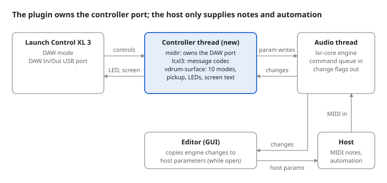

The controller thread is new; the audio thread, editor and their queues exist today. The controller never runs on the audio thread: it hands parameter writes to the same lock-free queue the editor uses, and reads the same changed-value flags the editor reads, so the controller's LEDs and screen follow host automation, editor edits and kit loads. Host MIDI keeps reaching the engine as now; in DAW mode the controller sends nothing to the host's MIDI inputs, so there is no double handling and no MIDI learn conflict.

> **Correction (2026-11-04):** hosts can receive the device's DAW-port messages as well. Through the firmware's CC map these changed unrelated parameters, for example CC 103 on channel 1 (Track left) set Drum 1's overdrive. Since then the plugin passes no host CC to the engine: only MIDI-learned CCs act, and the firmware's CC/NRPN map is not used (see `plugin/README.md`, *MIDI*).

## Controls that are the same in every mode

With 16 mode slots, mode selection uses the panel's own button numbering: the top row is printed 1 to 8 and the bottom row 9 to 16, so **Shift + button N selects mode N**. While Shift is held the 16 buttons show the mode slots: the active mode's button pulses orange, the other modes are dim white, the empty slots off. Since 2026-11-05 Shift also combines with Page up/down (kits) and Solo/Arm (sticky sequencer view).

| Control | DAW CC (guide p.9) | Proposed function |
| --- | --- | --- |
| Shift + button 1 to 16 | 63 (ch 7) + 37 to 52 | Go to mode 1 to 16 (13 to 15 do nothing until assigned) |
| Track left / right | 103 / 102 | Sequencer view (mode 8, or Solo/Arm): select sequencer track 1 to 7; with Record held, clear that track's pattern. Nothing otherwise (modes are selected with Shift + button only). |
| Button with the Novation logo | 104 | Back to the previous mode (toggles between the last two) |
| Solo/Arm | 65 | Toggle the sequencer view: the 16 buttons are the step buttons of the selected track in any mode (always on in mode 8). Shift + Solo/Arm: sticky, the view stays on across mode changes. LED white while on, orange while sticky. |
| Mute/Select | 66 | Go to mode 10 (Perform). In the sequencer view, hold = pattern layer (a tap still goes to Perform). |
| Page up / down | 106 / 107 | Sequencer view: bar 1 to 4. Shift + Page up/down: browse the kit library's filled slots (with an empty library: the kits in the current kit's folder); Play loads the shown kit, any other control cancels. |
| Play | 116 | Load the browsed kit while browsing. Otherwise, sequencer running: stop it (internal clock) or silence it until Play is pressed again (host clock; the host transport keeps running). Otherwise: start (mode 8, internal clock) or audition the current track (voice modes). |
| Record | 118 | Clear (hold): + a step clears the step, + Track left/right clears the selected track's pattern (sequencer view only). Live recording was removed on 2026-11-05. |
| Mode | none ("n/a" in the guide) | Owned by the device: DAW Mixer, DAW Control or custom modes. The plugin follows the report (CC 30, channel 7). |

Bottom row where a mode does not need it (modes 1 to 7 and 16): trigger pads for the seven tracks, and button 8 = Accent (pads play at velocity 127 while held).

Screen (128 x 64 pixels, guide p.15):

- Stationary display: mode number and name, kit name (mode 8: pattern, bar and the selected track; "silent" while Play has silenced the sequencer), last touched parameter.
- Temporary display on every control change: section, parameter name, and the value as the LXR-02 menu shows it (`lxr_params::format_value`), so `LP2`, `1/16`, `D2 Coarse`, not raw numbers.
- A fader that has not picked up its parameter yet shows the target value and the direction to move.

LEDs:

- Encoder LEDs take the colour of the parameter's section (voice modes) or of the track (column-per-track modes). Their brightness follows the value, as in the device's own modes: 10 % of the colour at the minimum, full at the maximum (added 2026-11-05). In DAW mode the device does not do this itself; the plugin sends each LED's RGB value.
- Toggles: bright when on, dim when off. Cycle buttons: section colour, briefly white on change.
- Trigger pads and Perform triggers flash when their track plays, from any source. Muted tracks are red.
- Sequencer steps: lit in the track colour where a step is set, white at the playhead.

Encoders run in relative mode on all three rows, so they never jump after a mode change. Faders are absolute; after a mode change the plugin ignores a fader until it crosses the parameter's current value (pickup).

## The modes

Each image is the supplied front-panel photo, darkened, with the proposed function on every control. Colour = section, or the track's colour in column-per-track modes (legend under each image). The small grey number is the control's DAW-mode CC. The same mappings as text, with parameter IDs, are in [control-tables.md](control-tables.md). The PNGs are in `images/`.

### Voice modes (1 to 7): shared layout

Columns follow the LXR-02's menu pages (Oscillator, Amp EG, Pitch mod EG or metal oscillators, FM or noise, Transient, Filter), then Velocity and Mix. Knob row 3 is the voice's LFO (8 parameters, 8 knobs). Faders carry the main value of each column. Lists of up to 14 entries are cycle buttons on the top row; the 229-entry LFO and velocity destinations are encoders. Top buttons 2 and 3 are Copy voice and Paste voice (hold 1 s; pastes between voices of the same kind: drums 1 to 3, or the two hi-hats). The bottom row is trigger pads.

Every parameter of the voice is on its page. Checked with a script against `lxr-params` plus the proposed open hi-hat IDs: 37 of 37 for drums 1 to 3 and cymbal, 36 of 36 for the snare and for each hi-hat, no duplicates.

### Mode 1: Drum 1

Modes 2 and 3 are identical with the Drum 2 and Drum 3 parameters. Knob 2 of column 5 is unassigned in the drum modes.

### Mode 2: Drum 2

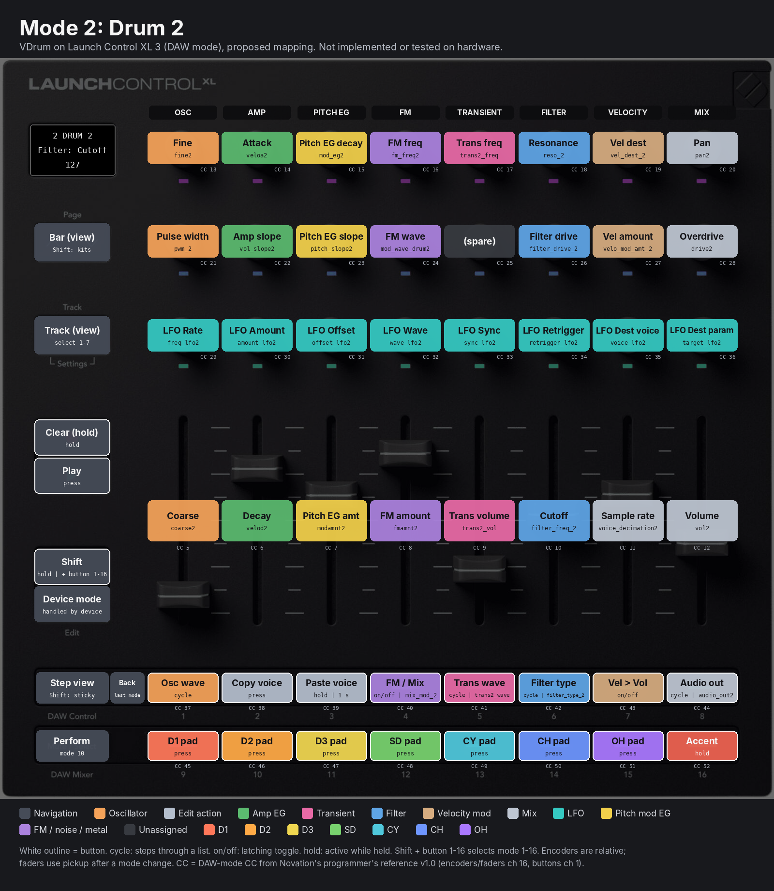

### Mode 3: Drum 3

### Mode 4: Snare

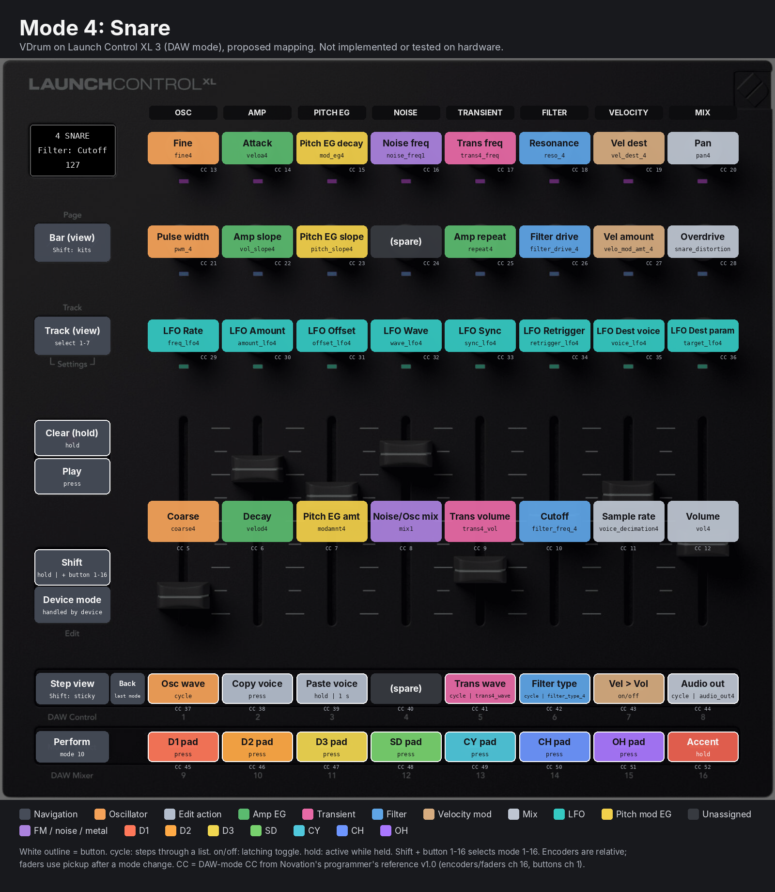

The snare has no FM, so column 4 holds the noise oscillator. The amp repeat count sits on knob 2 of column 5, the slot reserved in every voice mode for a fourth amp parameter.

### Mode 5: Cymbal

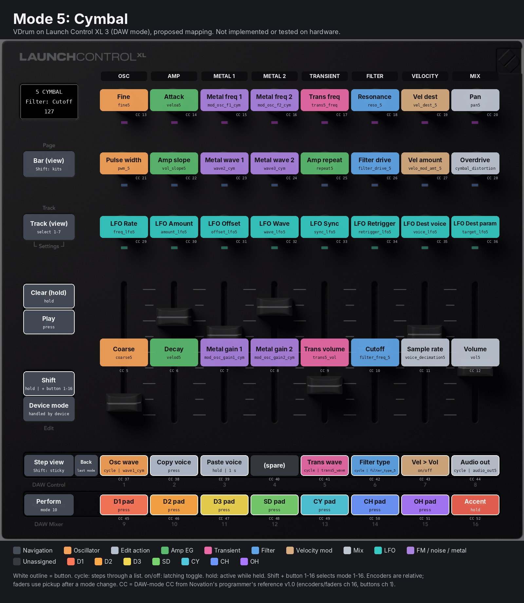

Columns 3 and 4 hold the two metallic modulation oscillators. Repeat count is in the same slot as the snare's.

### Mode 6: Closed hi-hat

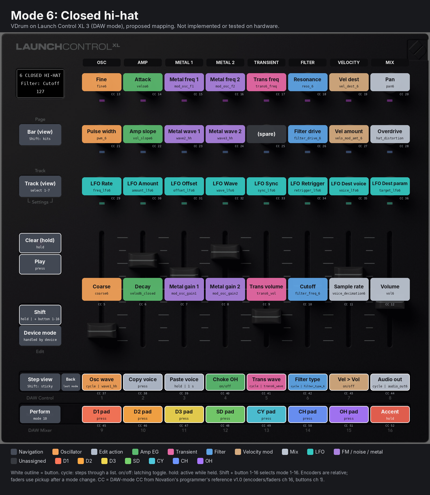

### Mode 7: Open hi-hat

The closed and open hi-hat are now two voices with the same layout and separate parameters. The open hat's parameters do not exist yet; the proposed IDs follow the existing pattern with a 7 or `_oh` suffix (`coarse7`, `velod7`, `mod_osc_f1_oh`, `oh_distortion`, 37 in all including `vdrum_fader_7`). On the LXR-02 an open hat is cut by the next closed hat because both are one voice. With two voices that behaviour needs a choke: top button 4 in both modes is the same switch, "closed hat chokes open hat", on by default.

### Mode 8: Sequencer

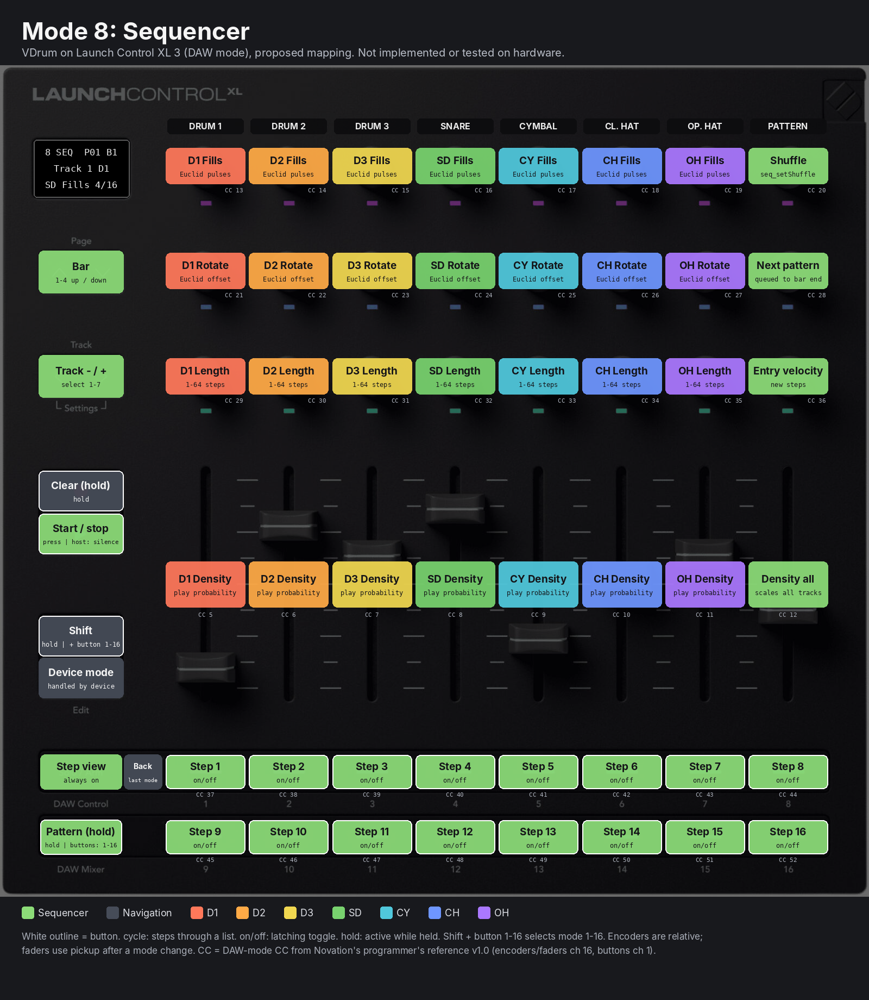

Goal: sequence any track, or several at once, without visiting its voice mode, with one knob per function. The design has three ideas.

1. **Columns are tracks, knobs are pattern generators.** Each of columns 1 to 7 is one track: Fills (Euclid pulses), Rotate (Euclid offset), Length (1 to 64 steps, so tracks can run polymetric) and a Density fader (playback probability, top = every step plays). This builds a groove from the knobs alone, for all seven tracks at once. Fills uses the engine's Euclid generator (`euklid_setSteps`, `euklid_setRotation`) and rewrites that track's steps; hand-set steps are kept until Fills is turned. Column 8: shuffle, next pattern (switches at the bar end), entry velocity, and a Density-all fader for build-ups.
2. **The 16 buttons are the 16 steps of the current bar, for the edit group.** *(Superseded 2026-11-05: the edit group was removed; steps are edited on the selected track only, and the step buttons are also available in other modes through the Solo/Arm sequencer view.)* The edit group is one or more tracks. Hold Solo/Arm: the top row shows the seven tracks; press to add or remove them from the group (button 8 = all or none). A step press then sets or clears that step on every track in the group at once: kick and open hat together, or all three drums. Where the group disagrees, a press sets the step on all. Page up/down moves between bars 1 to 4. Hold Mute/Select: the 16 buttons are patterns 1 to 16, queued to the bar end.

   **Selected track (added 2026-11-05).** Track left/right select one of the seven tracks; the selected track becomes the edit group, the step buttons show its steps, the display shows it, and its column's knob LEDs pulse slowly (1.2 s period) at their value brightness. ~~Solo/Arm can still add tracks to the group; the step buttons then show the selected track first.~~ (Removed 2026-11-05.)
3. **Hold a step, turn a knob.** While one or more steps are held, knob rows 1 and 2 change meaning (second image): row 1 = step velocity, probability, note, flam/ratchet, micro-shift, and the values of the step's two automation locks; row 2 = lock targets (pitch, decay, cutoff, resonance, drive, pan, sample rate, FX send). Turning a row-2 knob stores a parameter lock on the held steps of the selected track (each track of the group until 2026-11-05). In the sequencer view of other modes, holding a step and moving any knob or fader that controls a parameter locks that parameter instead. The engine has two automation slots per step (`param1Nr/Val`, `param2Nr/Val`); a third lock replaces the oldest, and the screen says so. Row 3 and the faders keep their track functions.

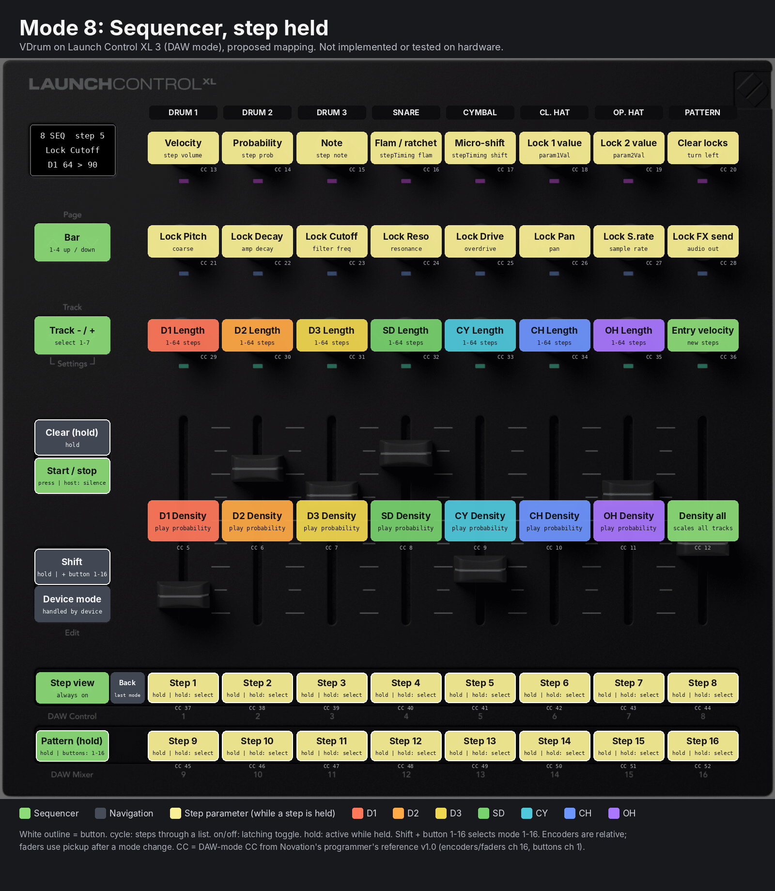

~~Recording: with Record armed and the sequence running, trigger pads (modes 1 to 7, 16) and Perform triggers write steps at the playhead, so a part can be played in and then edited here.~~ Removed 2026-11-05; Record is now Clear (see the table above).

Clock: the engine's sequencer is driven from the host transport when hosted. The Global mode clock setting switches to the internal clock (`bpm`), for the standalone app, and then Play starts and stops it. With the host clock, Play silences the running sequencer (it keeps following the host) until pressed again. How the plugin feeds the host transport to the engine is an implementation question (see the plan).

### Mode 9: Mix + FX

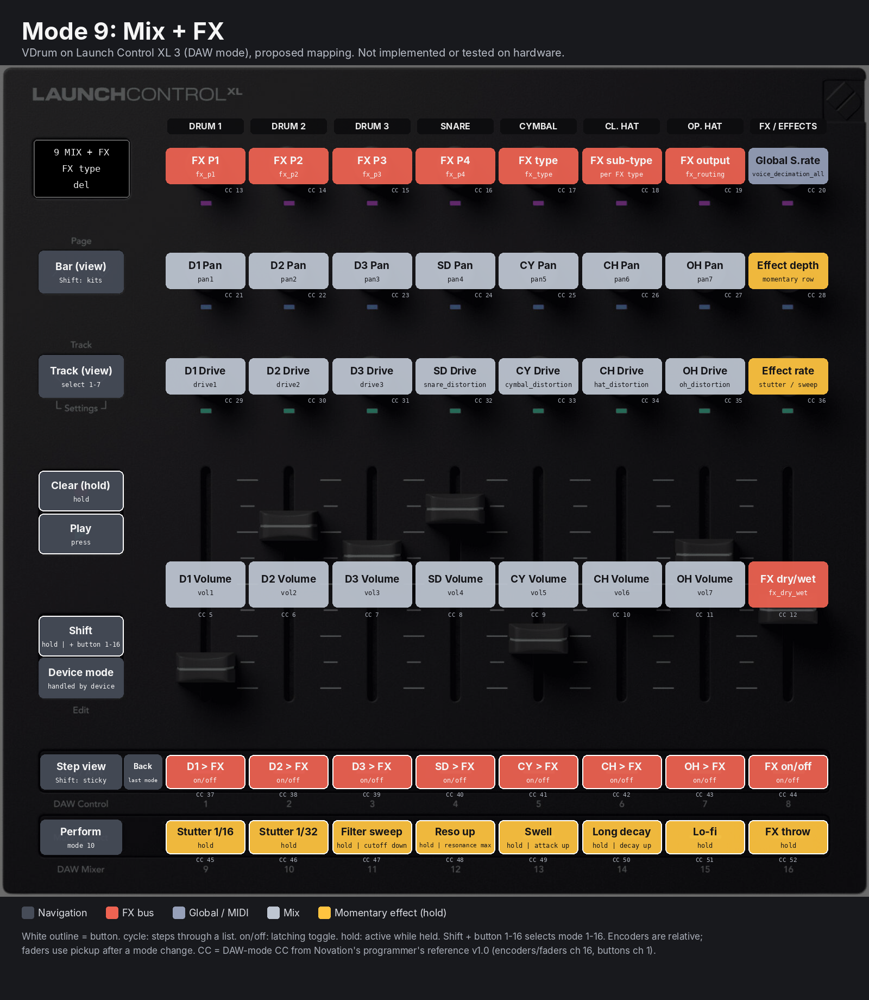

Knob row 1 is the FX bus (P1 to P4, type, type-specific sub-type, output) and the global sample rate. Rows 2 and 3 and the faders are pan, drive and volume for the seven voices. Top buttons send a voice to the FX bus (`audio_out = FX`; pressed again, the previous output returns), button 8 switches the FX off and back on. P1 to P4 are named per FX type on the screen: drive (overdrive, colour, tone, volume), ring mod (frequency), compressor (attack, decay, threshold, gain), delay (time, range, tone, feedback).

The bottom row holds the momentary effects, active while held, restored exactly on release (the plugin keeps the previous values): Stutter 1/16, Stutter 1/32 (repeat the last hits of every track at host tempo), Filter sweep (cutoffs down), Reso up, Swell (attacks up), Long decay, Lo-fi (global sample rate down), FX throw (all voices to FX, wet up). They act on all voices. Knobs 2 and 3 of column 8 set how far the effects go and the stutter/sweep rate.

### Mode 10: Perform

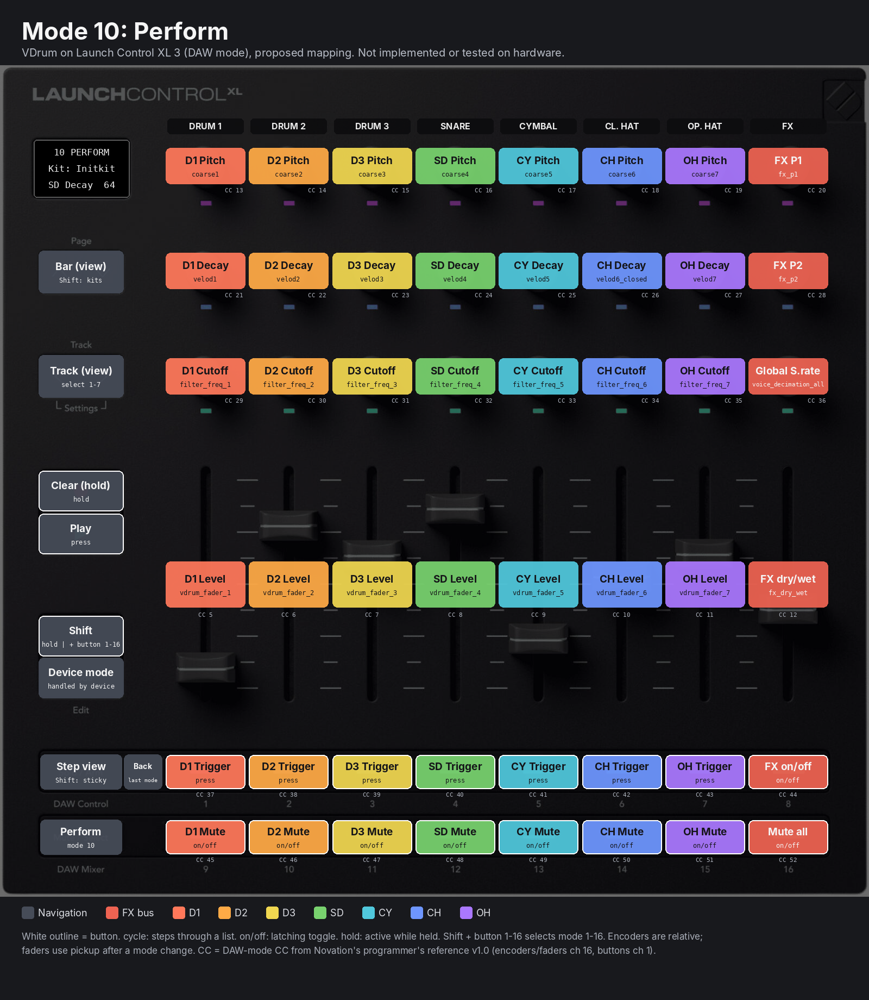

One column per track: pitch, decay, cutoff, level, trigger, mute. With separate hi-hat voices, column 7 now matches the others. Levels are the voice faders (`vdrum_fader_1` to `_7`, not stored in the kit). Column 8 is the FX bus. Mute is a plugin feature: the plugin drops the track's triggers before they reach the engine, so a muted voice still finishes its decay.

### Mode 11: LFO + Mod

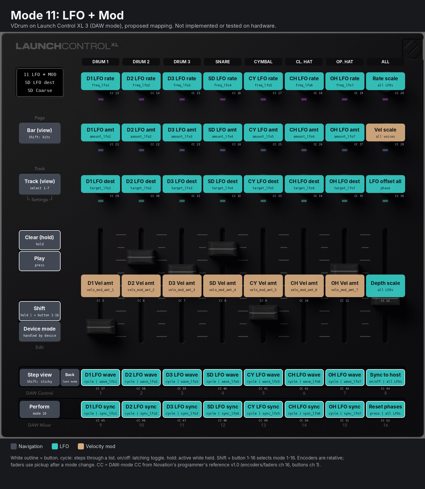

The modulation of every voice on one page: per track LFO rate, amount and destination (knobs), velocity amount (fader), LFO waveform and sync (cycle buttons). Column 8 holds new plugin-level controls: rate scale and depth scale for all LFOs (non-destructive multipliers), velocity scale, an offset for all LFO phases, sync-to-host, and a phase reset. Offset, retrigger and destination voice remain in the voice modes.

### Mode 12: Morph + Macro

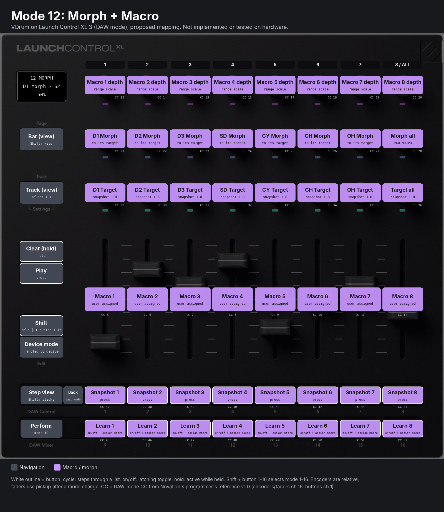

- **Snapshots** (top row): eight stored kits; press to recall, hold 1 s to store.
- **Morph** (knob rows 2 and 3): each track has a morph amount and a target snapshot, so one voice can move toward another sound while the rest stay. Column 8 morphs the whole kit; the engine's own morph (`PAR_MORPH`, `preset_morph`) covers that case, the per-voice version is plugin-side interpolation.
- **Macros** (faders, knob row 1): eight faders, each moving any set of parameters. Press Learn N (bottom row), move controls in any mode, press Learn N again; the movement range of each control becomes its macro range. Knob row 1 scales each macro's ranges. Macros can also be assigned in the editor.

### Mode 16: Global

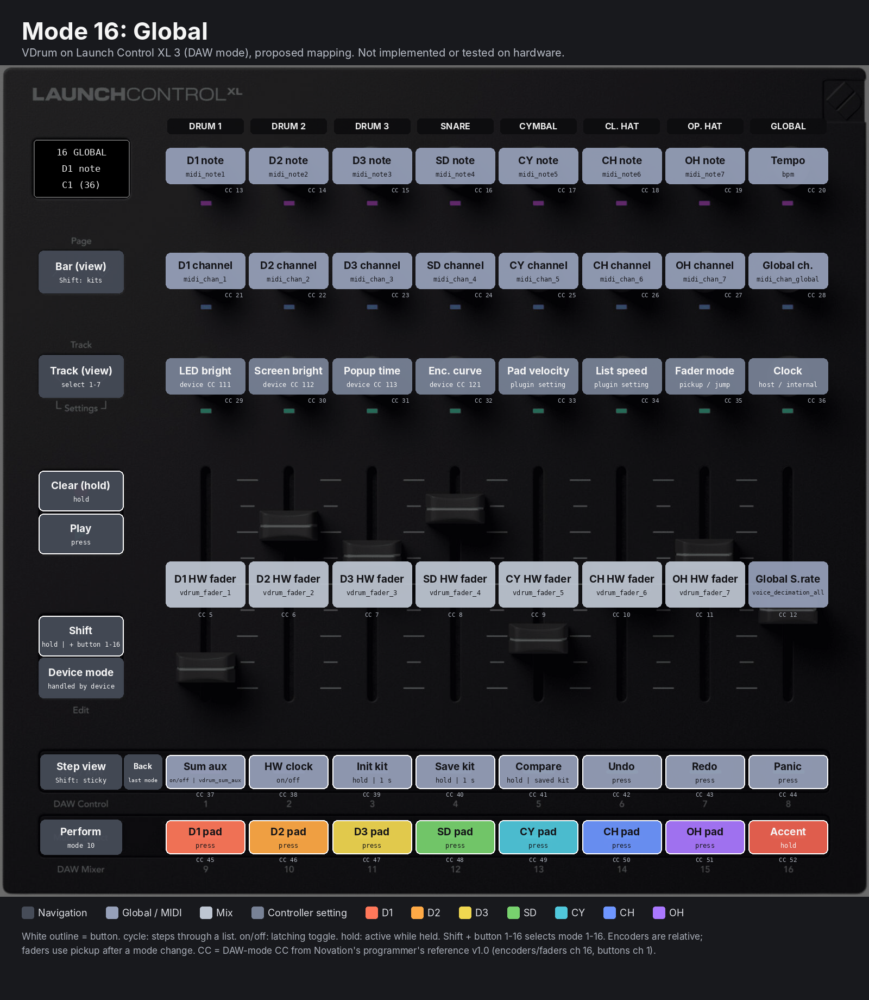

Trigger note and MIDI channel per track, tempo, global channel, the seven voice faders, global sample rate, sum aux and hardware clock switches, init and save kit (hold 1 s), compare (hold: hear the kit as last saved), undo, redo and panic. Knob row 3 holds controller settings: four device feature controls from the guide (LED brightness CC 111, screen brightness CC 112, temporary-display timeout CC 113, encoder curve CC 121), plus pad velocity, list speed, fader mode and clock source. The bottom row is trigger pads.

> **Addendum (kit library, 2026-11-04):** Page up/down now browses the plugin's kit library (64 slots) when it holds kits, and *Save kit* writes the selected library slot. With an empty library the folder browsing described here is unchanged. See `plugin/README.md`, "Kit library", and `editor-tabs-and-kit-library-plan.md`, Part C.

> **Addendum (editor mode tabs, 2026-11-04):** the plugin editor has one tab per mode above (13 tabs, after a *Params* tab). Each draws the front panel from the surface's state, follows mode changes made on the controller ("Follow controller", on by default), sets the controller's mode when clicked, and accepts mouse edits that run through the same handlers as the device. A pill row shows the last hardware edit (1.5 s) and the active context layers. See `plugin/README.md`, "GUI", and `editor-tabs-and-kit-library-plan.md`, Part B.

## Device protocol used

All messages go over the device's DAW In/Out USB port (the second interface on Windows). The guide states that in DAW mode surface controls report on that port only and that nothing is sent from the DIN outputs. SysEx header: `F0 00 20 29 02 15`.

| Purpose | Message | Guide page |
| --- | --- | --- |
| Enter DAW mode | `9F 0C 7F` or `F0 00 20 29 02 15 02 7F F7` | 8 |
| Leave DAW mode (plugin unload, controller off) | `9F 0C 00` or `F0 00 20 29 02 15 02 00 F7` | 8 |
| Encoders (absolute) | CC 13 to 36 on channel 16 | 9 |
| Encoders (relative) | Enable per row with `B6 45/48/49 7F`; rows then send CC 77 to 84, 85 to 92, 93 to 100; 64 = no movement, 65 = one step clockwise, 63 = one step anticlockwise | 10 |
| Faders | CC 5 to 12 on channel 16 | 9 |
| Buttons | CC 37 to 52 (rows), 65, 66, 102, 103, 104, 106, 107, 116, 118 on channel 1 | 9 |
| Shift | CC 63 on channel 7 | 9, 17 |
| Surface mode report / select | CC 30 on channel 7: 1 DAW Mixer, 2 DAW Control, 6 to 9 and 18 to 29 custom modes | 10, 17 |
| Fader pickup (device side) | CC 70 on channel 7, on/off | 17 |
| Touch events | CC 71 on channel 7 enables; touch on/off then arrive as CC 127/0 on channel 15 | 10 to 11 |
| LED, palette colour | `B0 <control CC> <palette index 0-127>` | 11 to 12 |
| LED, RGB | `F0 00 20 29 02 15 01 53 <control CC> <R> <G> <B> F7` (buttons and encoder LEDs) | 12 |
| Display configure | `F0 00 20 29 02 15 04 <target> <config> F7`; targets 5 to 36 (one per fader/encoder), 53 stationary, 54 overlay; config bits 0-4 arrangement, bit 5 auto display on touch, bit 6 auto display on change | 13 to 14 |
| Display text | `F0 00 20 29 02 15 06 <target> <field> <ASCII 32-126> F7` | 14 |
| Display bitmap | `F0 00 20 29 02 15 09 <target> <1216 bytes> ...`, 128 x 64 pixels, reply when ready for the next | 14 to 15 |
| Device settings | CC 111 LED brightness, 112 screen brightness, 113 display timeout, 121 encoder curve, on channel 7 (non-volatile) | 17 |

Arrangements documented (p.14): 1 = name + text value, 2 = title + name + text value, 3 = title + 8 names (2 x 4), 4 = name + numeric value (default). The plan uses 2 for per-control popups and the stationary display, and 3 to show the eight top-button functions while Shift is held.

## Implementation plan

The work is split into phases, each delivered as its own pull request and never merged to main by Claude. PR #2 (the earlier custom-mode work) has been closed and is not part of this plan.

1. **Engine: split closed and open hi-hat (voice 7).** Add a seventh voice to lxr-core and lxr-params with 37 new parameter IDs for the open hat (coarse7, velod7, mod\_osc\_f1\_oh, oh\_distortion, vdrum\_fader\_7, wave1\_oh and the rest listed in `source/layout.py`). Add a choke option (closed hat chokes open hat, proposed default on). Bump the kit format version. Legacy .snd import maps `velod6_open` and the shared hat settings to voice 7. Consequence: the bit-exact firmware difftests no longer apply to hi-hat scenarios; they remain valid for voices 1 to 5.
2. **`crates/lcxl3`: device codec.** Encode and decode the DAW-mode messages from the programmer's reference v1.0: DAW mode on/off, relative encoder mode, LED colour (CC and RGB SysEx), display configure and text, Shift and surface-mode reports. Pure functions, unit-tested against byte strings from the guide.
3. **`crates/vdrum-surface`: state machine.** Holds current mode, held buttons, fader pickup state, selected step and edit group. Input: decoded controller events. Output: parameter changes, engine commands, LED and display frames. Mappings are generated from the same table as `source/layout.py`. Tested without hardware.
4. **Plugin controller thread.** Opens the LCXL3 DAW port with midir, enables DAW mode, feeds the surface, writes parameter changes through the existing lock-free command queue, and pushes LED and display updates at a fixed rate. Only one plugin instance owns the device. Host parameter sync must work with the editor closed (at present it runs only while the editor is open).
5. **Voice modes 1 to 7, Mix + FX (9), Global (16).** Direct parameter pages, plus voice copy and paste.
6. **Sequencer mode (8).** Drive the ported engine sequencer from host transport (tempo, start/stop, song position). Pattern data moves into plugin state so it is saved with the project. Implements step buttons, edit group, Euclid fills/rotate/length, density, step-held parameter locks and record arm.
7. **Perform (10), LFO + Mod (11), Morph + Macro (12).** Adds mutes, momentary effects (Mix + FX bottom row), snapshots (store on 1 s hold), kit morph via `PAR_MORPH`, macros and undo.
8. **Hardware test pass.** Check each item in the unverified list below on a real LCXL3.

## Unverified items and open questions

**Unverified (needs a real LCXL3 or a code check):**

- ~~Whether Shift + top/bottom-row button combinations reach the host in DAW mode.~~ Confirmed on the hardware (2026-11-05): Shift + button N selects mode N. `VDRUM_LCXL3_LOG=<file>` logs every message the device sends, for checks like this one.
- Whether a held button plus encoder turns arrive cleanly enough for step-held editing (mode 8) without accidental step toggles on release.
- Display text field lengths per arrangement; the screen texts in the images are illustrative.
- The parameter value range the engine's per-step parameter locks (`param1Val`, `param2Val`) accept, and whether every parameter can be a lock target.
- RGB SysEx LED update rate the device tolerates while the sequencer playhead moves.

**Open questions** (as written on 2026-11-03; 1, 2, 3 and 5 were settled by the implementation, see `plugin/README.md`; host transport uses the engine's external-clock path rather than a direct call; 4 is still open):

1. How should host transport reach the engine sequencer: a direct call from the plugin's process block (proposed), or synthesised MIDI clock/start/SPP into the engine's existing MIDI path?
2. Should the momentary effects act on all voices, or only on voices routed to the FX send (proposed: all voices)?
3. Choke default for the split hats: closed chokes open, on by default (proposed)?
4. Modes 13 to 15 are unassigned. Candidates: a second sequencer page for locks, a sample/kit browser, or a song/pattern-chain page.
5. Item 2 of your answers (split hi-hat) is read as a design change now, implemented as phase 1 in its own PR when you ask for implementation. Confirm that reading, and whether implementation should start.

## Sources

- Novation, *Launch Control XL 3 programmer's reference guide* v1.0 (PDF): https://fael-downloads-prod.focusrite.com/customer/prod/downloads/launch\_control\_xl\_3\_programmer\_s\_reference\_guide-pdf\_en.pdf. The help-centre pages linked in the request return HTTP 403 to automated fetches.
- VDrum repository, sazl/vdrum (main): lxr-core sequencer and preset morph, lxr-params parameter metadata (249 parameters).
- PR #2 (custom-mode integration): closed and removed, per your instruction.
