# Control tables (generated)

Generated from the surface spec (`surface/`) by `python3 tools/surface_spec/run.py build`; do not edit. Each cell is the label shown on the screen and what the control does: a parameter id in backticks, or a behaviour (`docs/lcxl3-daw-mode/surface-spec.md`, Behaviours). LED colours in the images are the section colours; the device dims or lights them by state.

## Mode 1: Drum 1

| Row | 1 | 2 | 3 | 4 | 5 | 6 | 7 | 8 |
| --- | --- | --- | --- | --- | --- | --- | --- | --- |
| Knob row 1 | Fine `fine1` | Attack `veloa1` | Pitch EG decay `mod_eg1` | FM freq `fm_freq1` | Trans freq `trans1_freq` | Resonance `reso_1` | Vel dest `vel_dest_1` | Pan `pan1` |
| Knob row 2 | Pulse width `pwm_1` | Amp slope `vol_slope1` | Pitch EG slope `pitch_slope1` | FM wave `mod_wave_drum1` | (unassigned) | Filter drive `filter_drive_1` | Vel amount `velo_mod_amt_1` | Overdrive `drive1` |
| Knob row 3 | LFO Rate `freq_lfo1` | LFO Amount `amount_lfo1` | LFO Offset `offset_lfo1` | LFO Wave `wave_lfo1` | LFO Sync `sync_lfo1` | LFO Retrigger `retrigger_lfo1` | LFO Dest voice `voice_lfo1` | LFO Dest param `target_lfo1` |
| Fader | Coarse `coarse1` | Decay `velod1` | Pitch EG amt `modamnt1` | FM amount `fmamnt1` | Trans volume `trans1_vol` | Cutoff `filter_freq_1` | Sample rate `voice_decimation1` | Volume `vol1` |
| Top button | Osc wave `osc_wave_drum1` | Copy voice copy_voice | Paste voice paste_voice | FM / Mix `mix_mod_1` | Trans wave `trans1_wave` | Filter type `filter_type_1` | Vel > Vol `volume_mod_on_off1` | Audio out `audio_out1` |
| Bottom button | D1 pad pad 0 | D2 pad pad 1 | D3 pad pad 2 | SD pad pad 3 | CY pad pad 4 | CH pad pad 5 | OH pad pad 6 | Accent accent |

## Mode 2: Drum 2

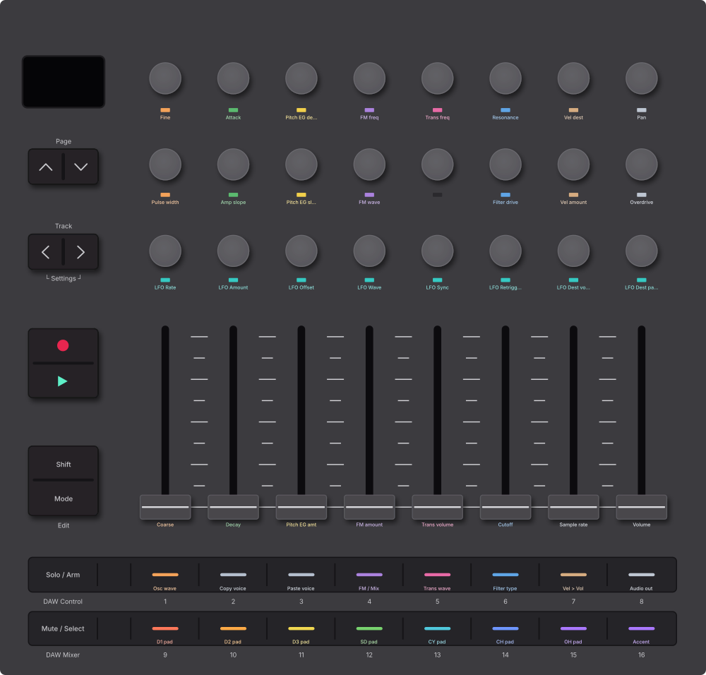

| Row | 1 | 2 | 3 | 4 | 5 | 6 | 7 | 8 |
| --- | --- | --- | --- | --- | --- | --- | --- | --- |
| Knob row 1 | Fine `fine2` | Attack `veloa2` | Pitch EG decay `mod_eg2` | FM freq `fm_freq2` | Trans freq `trans2_freq` | Resonance `reso_2` | Vel dest `vel_dest_2` | Pan `pan2` |
| Knob row 2 | Pulse width `pwm_2` | Amp slope `vol_slope2` | Pitch EG slope `pitch_slope2` | FM wave `mod_wave_drum2` | (unassigned) | Filter drive `filter_drive_2` | Vel amount `velo_mod_amt_2` | Overdrive `drive2` |
| Knob row 3 | LFO Rate `freq_lfo2` | LFO Amount `amount_lfo2` | LFO Offset `offset_lfo2` | LFO Wave `wave_lfo2` | LFO Sync `sync_lfo2` | LFO Retrigger `retrigger_lfo2` | LFO Dest voice `voice_lfo2` | LFO Dest param `target_lfo2` |
| Fader | Coarse `coarse2` | Decay `velod2` | Pitch EG amt `modamnt2` | FM amount `fmamnt2` | Trans volume `trans2_vol` | Cutoff `filter_freq_2` | Sample rate `voice_decimation2` | Volume `vol2` |
| Top button | Osc wave `osc_wave_drum2` | Copy voice copy_voice | Paste voice paste_voice | FM / Mix `mix_mod_2` | Trans wave `trans2_wave` | Filter type `filter_type_2` | Vel > Vol `volume_mod_on_off2` | Audio out `audio_out2` |
| Bottom button | D1 pad pad 0 | D2 pad pad 1 | D3 pad pad 2 | SD pad pad 3 | CY pad pad 4 | CH pad pad 5 | OH pad pad 6 | Accent accent |

## Mode 3: Drum 3

| Row | 1 | 2 | 3 | 4 | 5 | 6 | 7 | 8 |
| --- | --- | --- | --- | --- | --- | --- | --- | --- |
| Knob row 1 | Fine `fine3` | Attack `veloa3` | Pitch EG decay `mod_eg3` | FM freq `fm_freq3` | Trans freq `trans3_freq` | Resonance `reso_3` | Vel dest `vel_dest_3` | Pan `pan3` |
| Knob row 2 | Pulse width `pwm_3` | Amp slope `vol_slope3` | Pitch EG slope `pitch_slope3` | FM wave `mod_wave_drum3` | (unassigned) | Filter drive `filter_drive_3` | Vel amount `velo_mod_amt_3` | Overdrive `drive3` |
| Knob row 3 | LFO Rate `freq_lfo3` | LFO Amount `amount_lfo3` | LFO Offset `offset_lfo3` | LFO Wave `wave_lfo3` | LFO Sync `sync_lfo3` | LFO Retrigger `retrigger_lfo3` | LFO Dest voice `voice_lfo3` | LFO Dest param `target_lfo3` |
| Fader | Coarse `coarse3` | Decay `velod3` | Pitch EG amt `modamnt3` | FM amount `fmamnt3` | Trans volume `trans3_vol` | Cutoff `filter_freq_3` | Sample rate `voice_decimation3` | Volume `vol3` |
| Top button | Osc wave `osc_wave_drum3` | Copy voice copy_voice | Paste voice paste_voice | FM / Mix `mix_mod_3` | Trans wave `trans3_wave` | Filter type `filter_type_3` | Vel > Vol `volume_mod_on_off3` | Audio out `audio_out3` |
| Bottom button | D1 pad pad 0 | D2 pad pad 1 | D3 pad pad 2 | SD pad pad 3 | CY pad pad 4 | CH pad pad 5 | OH pad pad 6 | Accent accent |

## Mode 4: Snare

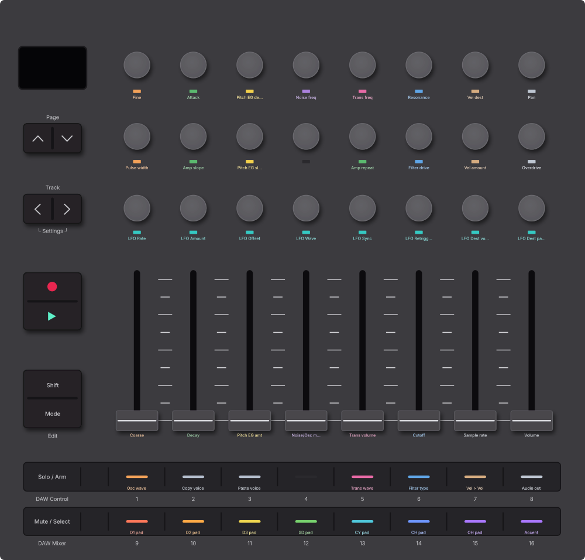

| Row | 1 | 2 | 3 | 4 | 5 | 6 | 7 | 8 |
| --- | --- | --- | --- | --- | --- | --- | --- | --- |
| Knob row 1 | Fine `fine4` | Attack `veloa4` | Pitch EG decay `mod_eg4` | Noise freq `noise_freq1` | Trans freq `trans4_freq` | Resonance `reso_4` | Vel dest `vel_dest_4` | Pan `pan4` |
| Knob row 2 | Pulse width `pwm_4` | Amp slope `vol_slope4` | Pitch EG slope `pitch_slope4` | (unassigned) | Amp repeat `repeat4` | Filter drive `filter_drive_4` | Vel amount `velo_mod_amt_4` | Overdrive `snare_distortion` |
| Knob row 3 | LFO Rate `freq_lfo4` | LFO Amount `amount_lfo4` | LFO Offset `offset_lfo4` | LFO Wave `wave_lfo4` | LFO Sync `sync_lfo4` | LFO Retrigger `retrigger_lfo4` | LFO Dest voice `voice_lfo4` | LFO Dest param `target_lfo4` |
| Fader | Coarse `coarse4` | Decay `velod4` | Pitch EG amt `modamnt4` | Noise/Osc mix `mix1` | Trans volume `trans4_vol` | Cutoff `filter_freq_4` | Sample rate `voice_decimation4` | Volume `vol4` |
| Top button | Osc wave `osc_wave_snare` | Copy voice copy_voice | Paste voice paste_voice | (unassigned) | Trans wave `trans4_wave` | Filter type `filter_type_4` | Vel > Vol `volume_mod_on_off4` | Audio out `audio_out4` |
| Bottom button | D1 pad pad 0 | D2 pad pad 1 | D3 pad pad 2 | SD pad pad 3 | CY pad pad 4 | CH pad pad 5 | OH pad pad 6 | Accent accent |

## Mode 5: Cymbal

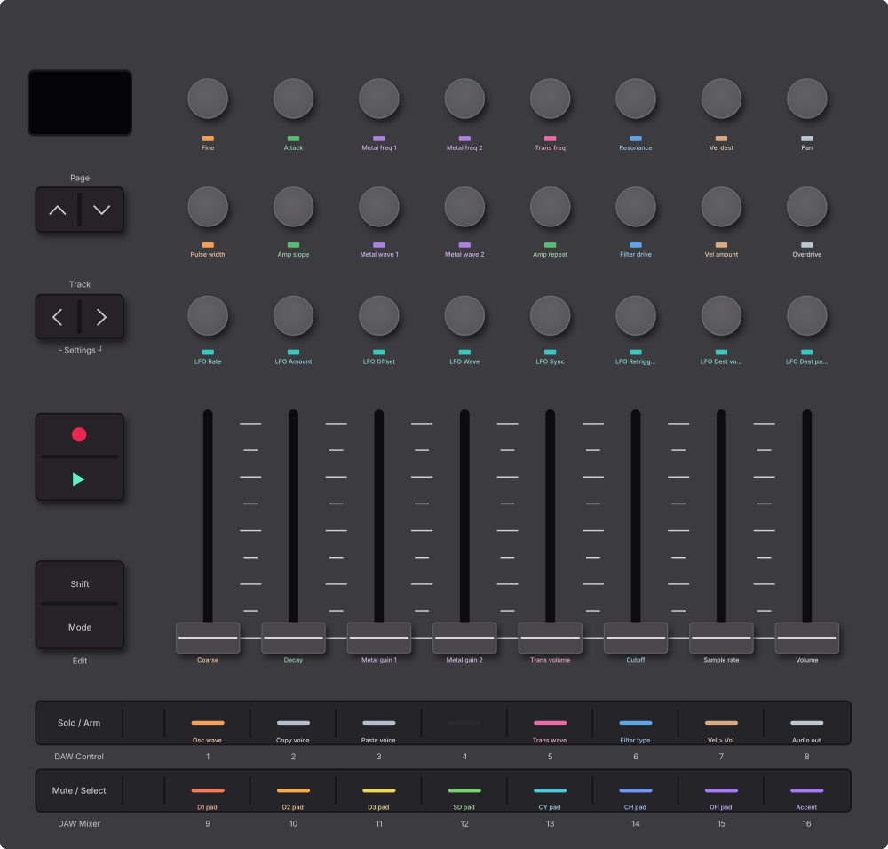

| Row | 1 | 2 | 3 | 4 | 5 | 6 | 7 | 8 |
| --- | --- | --- | --- | --- | --- | --- | --- | --- |
| Knob row 1 | Fine `fine5` | Attack `veloa5` | Metal freq 1 `mod_osc_f1_cym` | Metal freq 2 `mod_osc_f2_cym` | Trans freq `trans5_freq` | Resonance `reso_5` | Vel dest `vel_dest_5` | Pan `pan5` |
| Knob row 2 | Pulse width `pwm_5` | Amp slope `vol_slope5` | Metal wave 1 `wave2_cym` | Metal wave 2 `wave3_cym` | Amp repeat `repeat5` | Filter drive `filter_drive_5` | Vel amount `velo_mod_amt_5` | Overdrive `cymbal_distortion` |
| Knob row 3 | LFO Rate `freq_lfo5` | LFO Amount `amount_lfo5` | LFO Offset `offset_lfo5` | LFO Wave `wave_lfo5` | LFO Sync `sync_lfo5` | LFO Retrigger `retrigger_lfo5` | LFO Dest voice `voice_lfo5` | LFO Dest param `target_lfo5` |
| Fader | Coarse `coarse5` | Decay `velod5` | Metal gain 1 `mod_osc_gain1_cym` | Metal gain 2 `mod_osc_gain2_cym` | Trans volume `trans5_vol` | Cutoff `filter_freq_5` | Sample rate `voice_decimation5` | Volume `vol5` |
| Top button | Osc wave `wave1_cym` | Copy voice copy_voice | Paste voice paste_voice | (unassigned) | Trans wave `trans5_wave` | Filter type `filter_type_5` | Vel > Vol `volume_mod_on_off5` | Audio out `audio_out5` |
| Bottom button | D1 pad pad 0 | D2 pad pad 1 | D3 pad pad 2 | SD pad pad 3 | CY pad pad 4 | CH pad pad 5 | OH pad pad 6 | Accent accent |

## Mode 6: Closed hi-hat

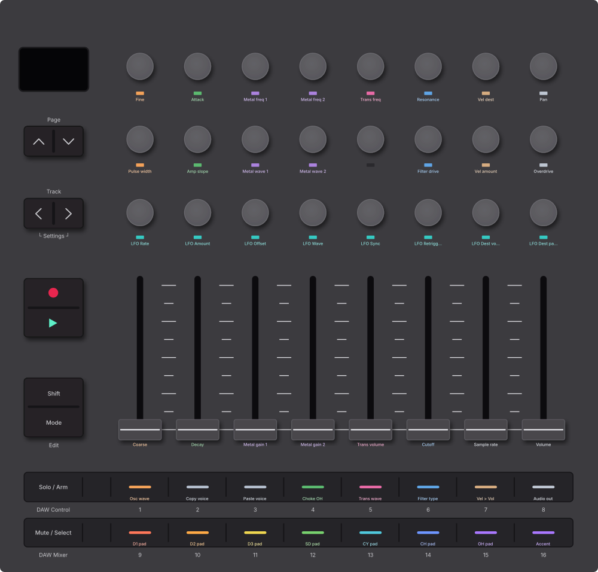

| Row | 1 | 2 | 3 | 4 | 5 | 6 | 7 | 8 |
| --- | --- | --- | --- | --- | --- | --- | --- | --- |
| Knob row 1 | Fine `fine6` | Attack `veloa6` | Metal freq 1 `mod_osc_f1` | Metal freq 2 `mod_osc_f2` | Trans freq `trans6_freq` | Resonance `reso_6` | Vel dest `vel_dest_6` | Pan `pan6` |
| Knob row 2 | Pulse width `pwm_6` | Amp slope `vol_slope6` | Metal wave 1 `wave2_hh` | Metal wave 2 `wave3_hh` | (unassigned) | Filter drive `filter_drive_6` | Vel amount `velo_mod_amt_6` | Overdrive `hat_distortion` |
| Knob row 3 | LFO Rate `freq_lfo6` | LFO Amount `amount_lfo6` | LFO Offset `offset_lfo6` | LFO Wave `wave_lfo6` | LFO Sync `sync_lfo6` | LFO Retrigger `retrigger_lfo6` | LFO Dest voice `voice_lfo6` | LFO Dest param `target_lfo6` |
| Fader | Coarse `coarse6` | Decay `velod6_closed` | Metal gain 1 `mod_osc_gain1` | Metal gain 2 `mod_osc_gain2` | Trans volume `trans6_vol` | Cutoff `filter_freq_6` | Sample rate `voice_decimation6` | Volume `vol6` |
| Top button | Osc wave `wave1_hh` | Copy voice copy_voice | Paste voice paste_voice | Choke OH `hat_choke` | Trans wave `trans6_wave` | Filter type `filter_type_6` | Vel > Vol `volume_mod_on_off6` | Audio out `audio_out6` |
| Bottom button | D1 pad pad 0 | D2 pad pad 1 | D3 pad pad 2 | SD pad pad 3 | CY pad pad 4 | CH pad pad 5 | OH pad pad 6 | Accent accent |

## Mode 7: Open hi-hat

| Row | 1 | 2 | 3 | 4 | 5 | 6 | 7 | 8 |
| --- | --- | --- | --- | --- | --- | --- | --- | --- |
| Knob row 1 | Fine `fine7` | Attack `veloa7` | Metal freq 1 `mod_osc_f1_oh` | Metal freq 2 `mod_osc_f2_oh` | Trans freq `trans7_freq` | Resonance `reso_7` | Vel dest `vel_dest_7` | Pan `pan7` |
| Knob row 2 | Pulse width `pwm_7` | Amp slope `vol_slope7` | Metal wave 1 `wave2_oh` | Metal wave 2 `wave3_oh` | (unassigned) | Filter drive `filter_drive_7` | Vel amount `velo_mod_amt_7` | Overdrive `oh_distortion` |
| Knob row 3 | LFO Rate `freq_lfo7` | LFO Amount `amount_lfo7` | LFO Offset `offset_lfo7` | LFO Wave `wave_lfo7` | LFO Sync `sync_lfo7` | LFO Retrigger `retrigger_lfo7` | LFO Dest voice `voice_lfo7` | LFO Dest param `target_lfo7` |
| Fader | Coarse `coarse7` | Decay `velod7` | Metal gain 1 `mod_osc_gain1_oh` | Metal gain 2 `mod_osc_gain2_oh` | Trans volume `trans7_vol` | Cutoff `filter_freq_7` | Sample rate `voice_decimation7` | Volume `vol7` |
| Top button | Osc wave `wave1_oh` | Copy voice copy_voice | Paste voice paste_voice | Choke by CH `hat_choke` | Trans wave `trans7_wave` | Filter type `filter_type_7` | Vel > Vol `volume_mod_on_off7` | Audio out `audio_out7` |
| Bottom button | D1 pad pad 0 | D2 pad pad 1 | D3 pad pad 2 | SD pad pad 3 | CY pad pad 4 | CH pad pad 5 | OH pad pad 6 | Accent accent |

## Mode 8: Sequencer

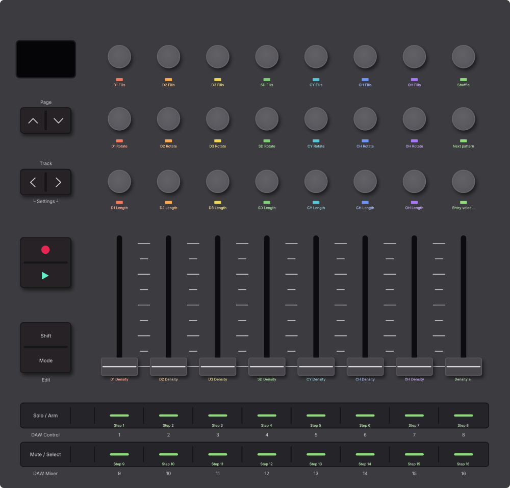

| Row | 1 | 2 | 3 | 4 | 5 | 6 | 7 | 8 |
| --- | --- | --- | --- | --- | --- | --- | --- | --- |
| Knob row 1 | D1 Fills seq_fills 0 | D2 Fills seq_fills 1 | D3 Fills seq_fills 2 | SD Fills seq_fills 3 | CY Fills seq_fills 4 | CH Fills seq_fills 5 | OH Fills seq_fills 6 | Shuffle seq_shuffle |
| Knob row 2 | D1 Rotate seq_rotate 0 | D2 Rotate seq_rotate 1 | D3 Rotate seq_rotate 2 | SD Rotate seq_rotate 3 | CY Rotate seq_rotate 4 | CH Rotate seq_rotate 5 | OH Rotate seq_rotate 6 | Next pattern seq_next_pattern |
| Knob row 3 | D1 Length seq_length 0 | D2 Length seq_length 1 | D3 Length seq_length 2 | SD Length seq_length 3 | CY Length seq_length 4 | CH Length seq_length 5 | OH Length seq_length 6 | Entry velocity seq_entry_velocity |
| Fader | D1 Density seq_density 0 | D2 Density seq_density 1 | D3 Density seq_density 2 | SD Density seq_density 3 | CY Density seq_density 4 | CH Density seq_density 5 | OH Density seq_density 6 | Density all seq_density_all |
| Top button | Step 1 seq_step 0 | Step 2 seq_step 1 | Step 3 seq_step 2 | Step 4 seq_step 3 | Step 5 seq_step 4 | Step 6 seq_step 5 | Step 7 seq_step 6 | Step 8 seq_step 7 |
| Bottom button | Step 9 seq_step 8 | Step 10 seq_step 9 | Step 11 seq_step 10 | Step 12 seq_step 11 | Step 13 seq_step 12 | Step 14 seq_step 13 | Step 15 seq_step 14 | Step 16 seq_step 15 |

## Mode 8: Sequencer, step held

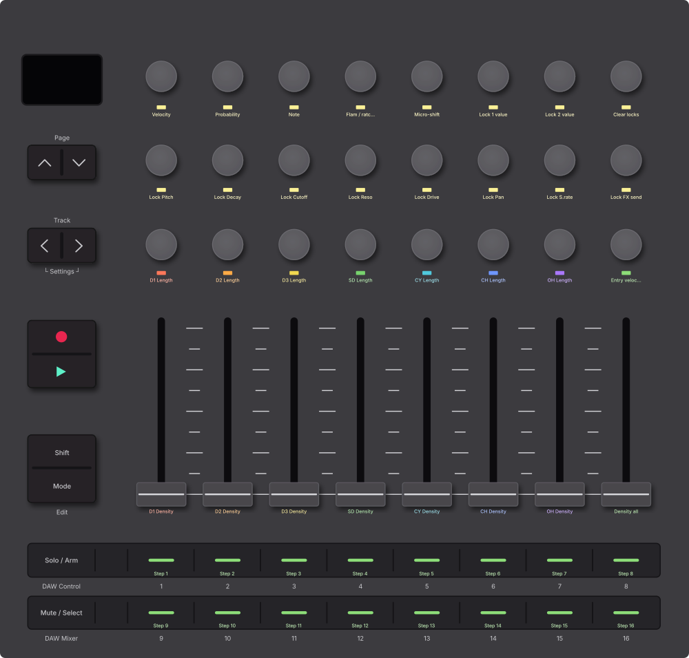

| Row | 1 | 2 | 3 | 4 | 5 | 6 | 7 | 8 |
| --- | --- | --- | --- | --- | --- | --- | --- | --- |
| Knob row 1 | Velocity step_field velocity | Probability step_field probability | Note step_field note | Flam / ratchet step_field flam | Micro-shift step_field shift | Lock 1 value step_field lock1 | Lock 2 value step_field lock2 | Clear locks step_field clear_locks |
| Knob row 2 | Lock Pitch lock_target 0 | Lock Decay lock_target 1 | Lock Cutoff lock_target 2 | Lock Reso lock_target 3 | Lock Drive lock_target 4 | Lock Pan lock_target 5 | Lock S.rate lock_target 6 | Lock FX send lock_target 7 |
| Knob row 3 | D1 Length seq_length 0 | D2 Length seq_length 1 | D3 Length seq_length 2 | SD Length seq_length 3 | CY Length seq_length 4 | CH Length seq_length 5 | OH Length seq_length 6 | Entry velocity seq_entry_velocity |
| Fader | D1 Density seq_density 0 | D2 Density seq_density 1 | D3 Density seq_density 2 | SD Density seq_density 3 | CY Density seq_density 4 | CH Density seq_density 5 | OH Density seq_density 6 | Density all seq_density_all |
| Top button | Step 1 seq_step 0 | Step 2 seq_step 1 | Step 3 seq_step 2 | Step 4 seq_step 3 | Step 5 seq_step 4 | Step 6 seq_step 5 | Step 7 seq_step 6 | Step 8 seq_step 7 |
| Bottom button | Step 9 seq_step 8 | Step 10 seq_step 9 | Step 11 seq_step 10 | Step 12 seq_step 11 | Step 13 seq_step 12 | Step 14 seq_step 13 | Step 15 seq_step 14 | Step 16 seq_step 15 |

## Mode 9: Mix + FX

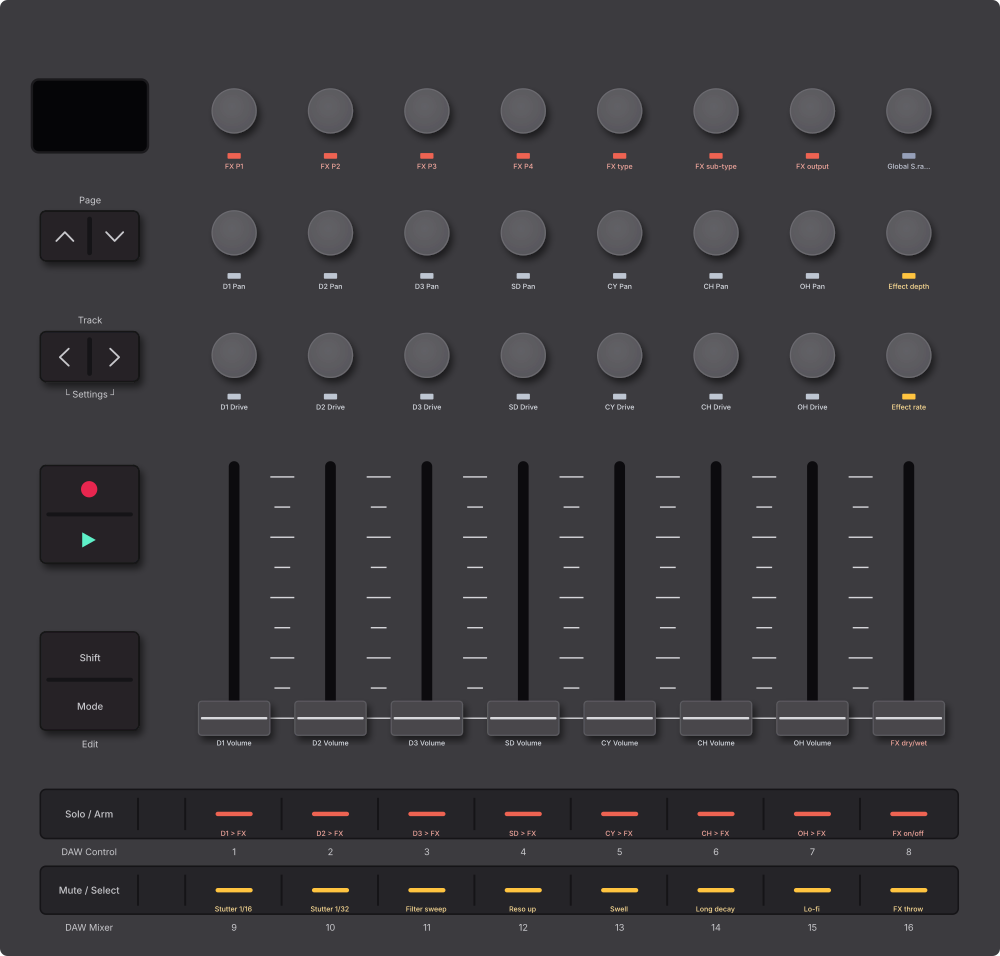

| Row | 1 | 2 | 3 | 4 | 5 | 6 | 7 | 8 |
| --- | --- | --- | --- | --- | --- | --- | --- | --- |
| Knob row 1 | FX P1 `fx_p1` | FX P2 `fx_p2` | FX P3 `fx_p3` | FX P4 `fx_p4` | FX type `fx_type` | FX sub-type fx_sub_type | FX output `fx_routing` | Global S.rate `voice_decimation_all` |
| Knob row 2 | D1 Pan `pan1` | D2 Pan `pan2` | D3 Pan `pan3` | SD Pan `pan4` | CY Pan `pan5` | CH Pan `pan6` | OH Pan `pan7` | Effect depth moment_depth |
| Knob row 3 | D1 Drive `drive1` | D2 Drive `drive2` | D3 Drive `drive3` | SD Drive `snare_distortion` | CY Drive `cymbal_distortion` | CH Drive `hat_distortion` | OH Drive `oh_distortion` | Effect rate moment_rate |
| Fader | D1 Volume `vol1` | D2 Volume `vol2` | D3 Volume `vol3` | SD Volume `vol4` | CY Volume `vol5` | CH Volume `vol6` | OH Volume `vol7` | FX dry/wet `fx_dry_wet` |
| Top button | D1 > FX to_fx 0 | D2 > FX to_fx 1 | D3 > FX to_fx 2 | SD > FX to_fx 3 | CY > FX to_fx 4 | CH > FX to_fx 5 | OH > FX to_fx 6 | FX on/off fx_on_off |
| Bottom button | Stutter 1/16 moment 0 | Stutter 1/32 moment 1 | Filter sweep moment 2 | Reso up moment 3 | Swell moment 4 | Long decay moment 5 | Lo-fi moment 6 | FX throw moment 7 |

## Mode 10: Perform

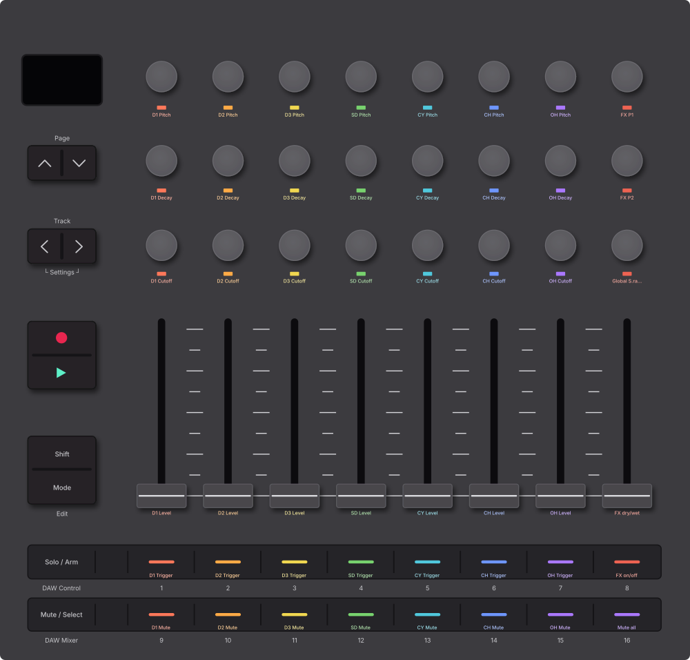

| Row | 1 | 2 | 3 | 4 | 5 | 6 | 7 | 8 |
| --- | --- | --- | --- | --- | --- | --- | --- | --- |
| Knob row 1 | D1 Pitch `coarse1` | D2 Pitch `coarse2` | D3 Pitch `coarse3` | SD Pitch `coarse4` | CY Pitch `coarse5` | CH Pitch `coarse6` | OH Pitch `coarse7` | FX P1 `fx_p1` |
| Knob row 2 | D1 Decay `velod1` | D2 Decay `velod2` | D3 Decay `velod3` | SD Decay `velod4` | CY Decay `velod5` | CH Decay `velod6_closed` | OH Decay `velod7` | FX P2 `fx_p2` |
| Knob row 3 | D1 Cutoff `filter_freq_1` | D2 Cutoff `filter_freq_2` | D3 Cutoff `filter_freq_3` | SD Cutoff `filter_freq_4` | CY Cutoff `filter_freq_5` | CH Cutoff `filter_freq_6` | OH Cutoff `filter_freq_7` | Global S.rate `voice_decimation_all` |
| Fader | D1 Level voice_fader 0 | D2 Level voice_fader 1 | D3 Level voice_fader 2 | SD Level voice_fader 3 | CY Level voice_fader 4 | CH Level voice_fader 5 | OH Level voice_fader 6 | FX dry/wet `fx_dry_wet` |
| Top button | D1 Trigger trigger 0 | D2 Trigger trigger 1 | D3 Trigger trigger 2 | SD Trigger trigger 3 | CY Trigger trigger 4 | CH Trigger trigger 5 | OH Trigger trigger 6 | FX on/off fx_on_off |
| Bottom button | D1 Mute mute 0 | D2 Mute mute 1 | D3 Mute mute 2 | SD Mute mute 3 | CY Mute mute 4 | CH Mute mute 5 | OH Mute mute 6 | Mute all mute_all |

## Mode 11: LFO + Mod

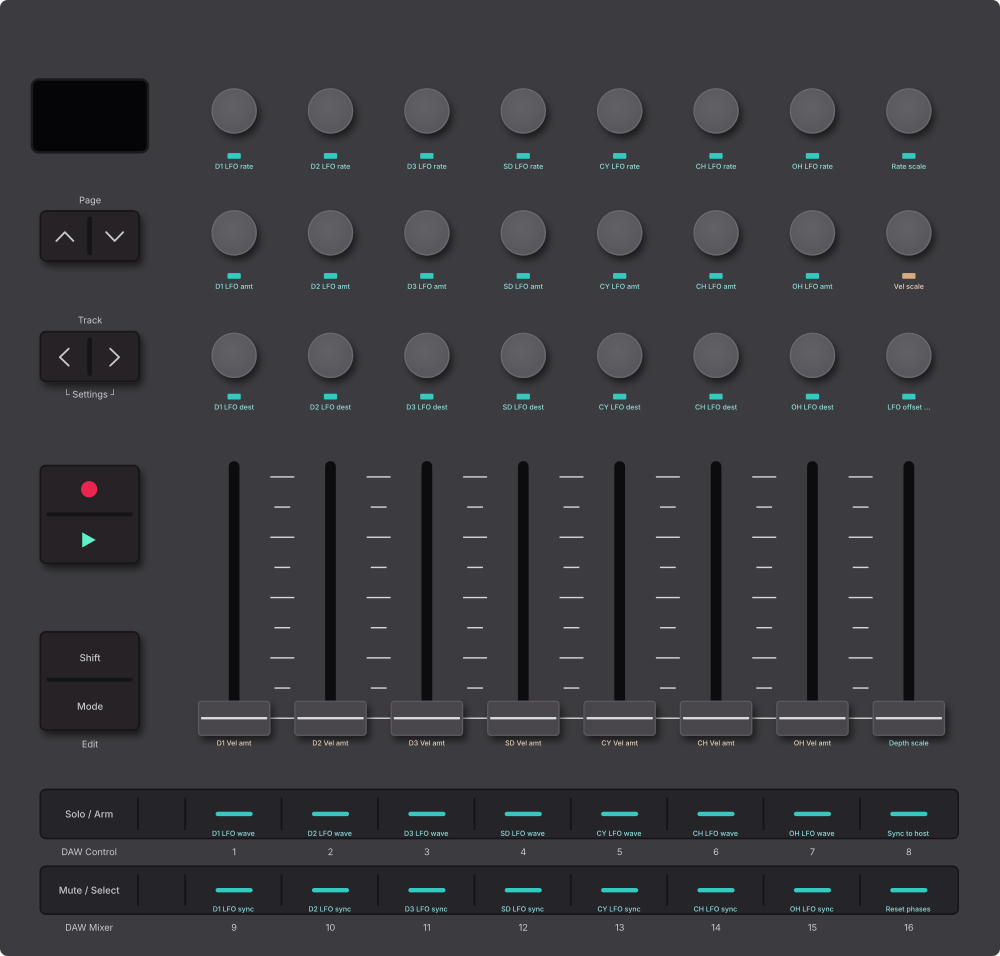

| Row | 1 | 2 | 3 | 4 | 5 | 6 | 7 | 8 |
| --- | --- | --- | --- | --- | --- | --- | --- | --- |
| Knob row 1 | D1 LFO rate `freq_lfo1` | D2 LFO rate `freq_lfo2` | D3 LFO rate `freq_lfo3` | SD LFO rate `freq_lfo4` | CY LFO rate `freq_lfo5` | CH LFO rate `freq_lfo6` | OH LFO rate `freq_lfo7` | Rate scale lfo_rate_scale |
| Knob row 2 | D1 LFO amt `amount_lfo1` | D2 LFO amt `amount_lfo2` | D3 LFO amt `amount_lfo3` | SD LFO amt `amount_lfo4` | CY LFO amt `amount_lfo5` | CH LFO amt `amount_lfo6` | OH LFO amt `amount_lfo7` | Vel scale vel_scale |
| Knob row 3 | D1 LFO dest `target_lfo1` | D2 LFO dest `target_lfo2` | D3 LFO dest `target_lfo3` | SD LFO dest `target_lfo4` | CY LFO dest `target_lfo5` | CH LFO dest `target_lfo6` | OH LFO dest `target_lfo7` | LFO offset all lfo_offset_all |
| Fader | D1 Vel amt `velo_mod_amt_1` | D2 Vel amt `velo_mod_amt_2` | D3 Vel amt `velo_mod_amt_3` | SD Vel amt `velo_mod_amt_4` | CY Vel amt `velo_mod_amt_5` | CH Vel amt `velo_mod_amt_6` | OH Vel amt `velo_mod_amt_7` | Depth scale lfo_depth_scale |
| Top button | D1 LFO wave `wave_lfo1` | D2 LFO wave `wave_lfo2` | D3 LFO wave `wave_lfo3` | SD LFO wave `wave_lfo4` | CY LFO wave `wave_lfo5` | CH LFO wave `wave_lfo6` | OH LFO wave `wave_lfo7` | Sync to host lfo_sync_host |
| Bottom button | D1 LFO sync `sync_lfo1` | D2 LFO sync `sync_lfo2` | D3 LFO sync `sync_lfo3` | SD LFO sync `sync_lfo4` | CY LFO sync `sync_lfo5` | CH LFO sync `sync_lfo6` | OH LFO sync `sync_lfo7` | Reset phases lfo_reset_phases |

## Mode 12: Morph + Macro

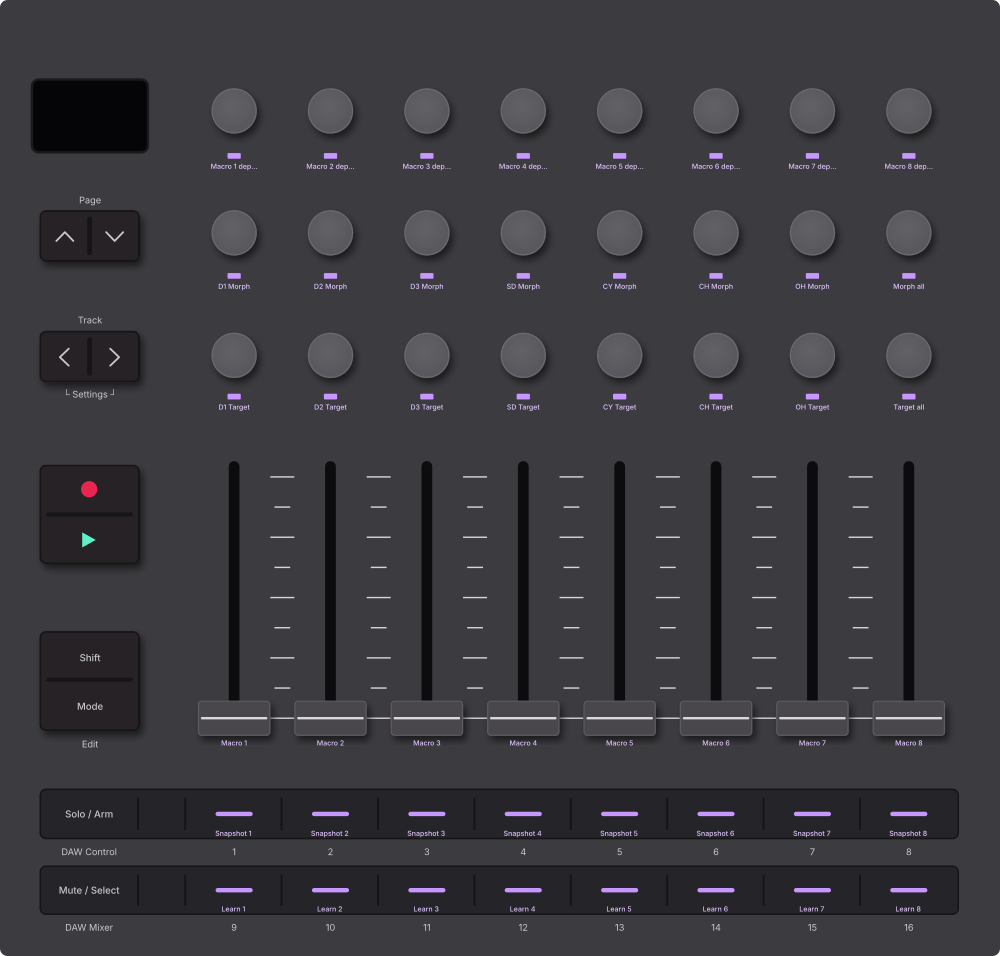

| Row | 1 | 2 | 3 | 4 | 5 | 6 | 7 | 8 |
| --- | --- | --- | --- | --- | --- | --- | --- | --- |
| Knob row 1 | Macro 1 depth macro_depth 0 | Macro 2 depth macro_depth 1 | Macro 3 depth macro_depth 2 | Macro 4 depth macro_depth 3 | Macro 5 depth macro_depth 4 | Macro 6 depth macro_depth 5 | Macro 7 depth macro_depth 6 | Macro 8 depth macro_depth 7 |
| Knob row 2 | D1 Morph track_morph 0 | D2 Morph track_morph 1 | D3 Morph track_morph 2 | SD Morph track_morph 3 | CY Morph track_morph 4 | CH Morph track_morph 5 | OH Morph track_morph 6 | Morph all morph_all |
| Knob row 3 | D1 Target track_target 0 | D2 Target track_target 1 | D3 Target track_target 2 | SD Target track_target 3 | CY Target track_target 4 | CH Target track_target 5 | OH Target track_target 6 | Target all target_all |
| Fader | Macro 1 macro 0 | Macro 2 macro 1 | Macro 3 macro 2 | Macro 4 macro 3 | Macro 5 macro 4 | Macro 6 macro 5 | Macro 7 macro 6 | Macro 8 macro 7 |
| Top button | Snapshot 1 snapshot 0 | Snapshot 2 snapshot 1 | Snapshot 3 snapshot 2 | Snapshot 4 snapshot 3 | Snapshot 5 snapshot 4 | Snapshot 6 snapshot 5 | Snapshot 7 snapshot 6 | Snapshot 8 snapshot 7 |
| Bottom button | Learn 1 learn 0 | Learn 2 learn 1 | Learn 3 learn 2 | Learn 4 learn 3 | Learn 5 learn 4 | Learn 6 learn 5 | Learn 7 learn 6 | Learn 8 learn 7 |

## Mode 16: Global

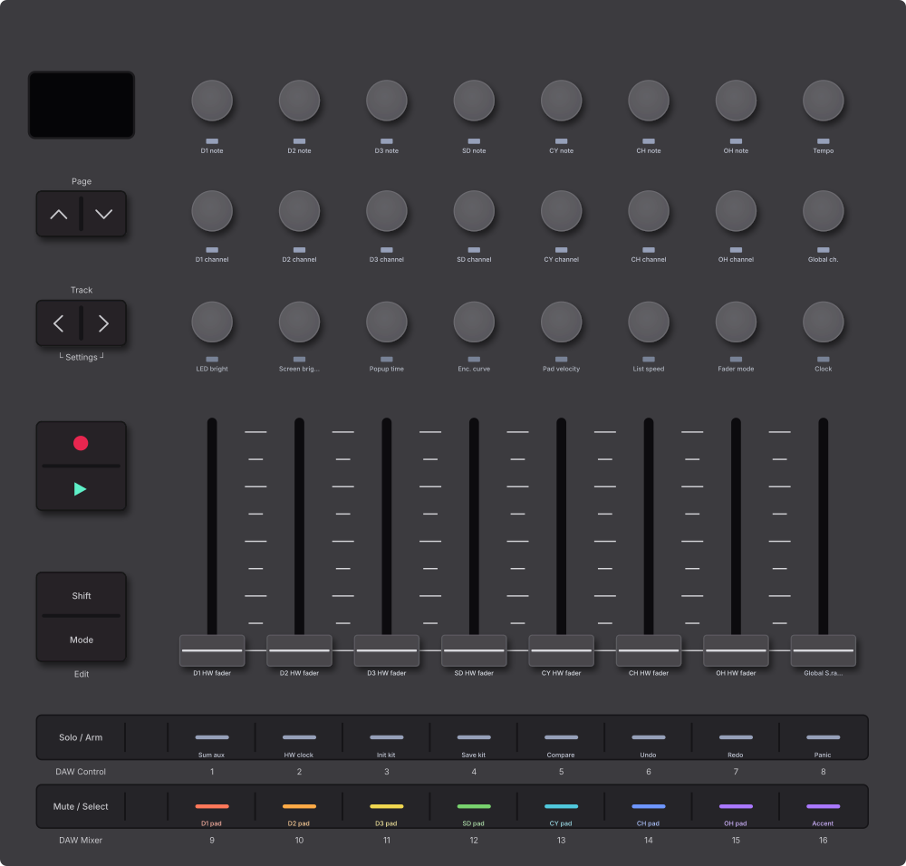

| Row | 1 | 2 | 3 | 4 | 5 | 6 | 7 | 8 |
| --- | --- | --- | --- | --- | --- | --- | --- | --- |
| Knob row 1 | D1 note `midi_note1` | D2 note `midi_note2` | D3 note `midi_note3` | SD note `midi_note4` | CY note `midi_note5` | CH note `midi_note6` | OH note `midi_note7` | Tempo `bpm` |
| Knob row 2 | D1 channel `midi_chan_1` | D2 channel `midi_chan_2` | D3 channel `midi_chan_3` | SD channel `midi_chan_4` | CY channel `midi_chan_5` | CH channel `midi_chan_6` | OH channel `midi_chan_7` | Global ch. `midi_chan_global` |
| Knob row 3 | LED bright setting led_brightness | Screen bright setting screen_brightness | Popup time setting popup_time | Enc. curve setting encoder_curve | Pad velocity setting pad_velocity | List speed setting list_speed | Fader mode setting fader_mode | Clock setting clock |
| Fader | D1 HW fader voice_fader 0 | D2 HW fader voice_fader 1 | D3 HW fader voice_fader 2 | SD HW fader voice_fader 3 | CY HW fader voice_fader 4 | CH HW fader voice_fader 5 | OH HW fader voice_fader 6 | Global S.rate `voice_decimation_all` |
| Top button | Sum aux sum_aux | HW clock hw_clock | Init kit init_kit | Save kit save_kit | Compare compare | Undo undo | Redo redo | Panic panic |
| Bottom button | D1 pad pad 0 | D2 pad pad 1 | D3 pad pad 2 | SD pad pad 3 | CY pad pad 4 | CH pad pad 5 | OH pad pad 6 | Accent accent |

## Sequencer view (Solo/Arm), laid over any mode

| Row | 1 | 2 | 3 | 4 | 5 | 6 | 7 | 8 |
| --- | --- | --- | --- | --- | --- | --- | --- | --- |
| Knob row 1 |  |  |  |  |  |  |  |  |
| Knob row 2 |  |  |  |  |  |  |  |  |
| Knob row 3 |  |  |  |  |  |  |  |  |
| Fader |  |  |  |  |  |  |  |  |
| Top button | Step 1 seq_step 0 | Step 2 seq_step 1 | Step 3 seq_step 2 | Step 4 seq_step 3 | Step 5 seq_step 4 | Step 6 seq_step 5 | Step 7 seq_step 6 | Step 8 seq_step 7 |
| Bottom button | Step 9 seq_step 8 | Step 10 seq_step 9 | Step 11 seq_step 10 | Step 12 seq_step 11 | Step 13 seq_step 12 | Step 14 seq_step 13 | Step 15 seq_step 14 | Step 16 seq_step 15 |
