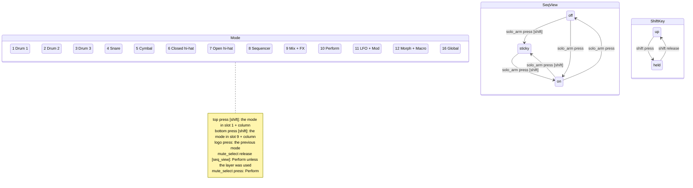

# Navigation (generated)

Generated from `surface/rules/` by `python3 tools/surface_spec/run.py build`; do not edit.

## State diagram

## Rules

The first rule whose button and guards match, and which has an entry for the event, handles it. "next rule": the event falls through.

| # | Button | When | Press | Release | Note |
| --- | --- | --- | --- | --- | --- |
| 1 | shift |  | shift | shift | Shift follows the button |
| 2 | solo_arm | shift | toggle_sticky | nothing | Shift + Solo/Arm: the sequencer view stays on across mode changes |
| 3 | top | shift | mode_slot(1) | next rule | Shift + top N: mode slot N |
| 4 | bottom | shift | mode_slot(9) | next rule | Shift + bottom N: mode slot 8 + N |
| 5 | top | seq_view | seq_button(0) | seq_button(0) | Sequencer view: steps 1 to 8 |
| 6 | bottom | seq_view | seq_button(8) | seq_button(8) | Sequencer view: steps 9 to 16 |
| 7 | track_left | seq_view held:record | clear_seq_track | nothing | Record + Track: clear the selected track |
| 8 | track_left | seq_view | seq_track_step(-1) | nothing | Sequencer view: select the track |
| 9 | track_left |  | nothing | nothing |  |
| 10 | track_right | seq_view held:record | clear_seq_track | nothing | Record + Track: clear the selected track |
| 11 | track_right | seq_view | seq_track_step(1) | nothing | Sequencer view: select the track |
| 12 | track_right |  | nothing | nothing |  |
| 13 | logo |  | previous_mode | nothing | Back to the previous mode |
| 14 | solo_arm | mode:sequencer | message(['Sequencer view', 'always on', 'in mode 8']) | nothing |  |
| 15 | solo_arm |  | toggle_seq_view | nothing | Solo/Arm: sequencer view on/off |
| 16 | mute_select | seq_view | layer_begin, message(['Sequencer', 'Patterns', 'patterns 1 to 16']) | mode_unless_layer_used(perform) | Pattern layer while held |
| 17 | mute_select |  | mode(perform) | nothing | Perform |
| 18 | page_up | shift | kit_browse(-1) | nothing | Shift + Page: browse kits, Play loads |
| 19 | page_up | seq_view | seq_bar_step(-1) | nothing | Sequencer view: bar |
| 20 | page_up |  | nothing | nothing |  |
| 21 | page_down | shift | kit_browse(1) | nothing | Shift + Page: browse kits, Play loads |
| 22 | page_down | seq_view | seq_bar_step(1) | nothing | Sequencer view: bar |
| 23 | page_down |  | nothing | nothing |  |
| 24 | record |  | message(['Clear', 'hold +', 'step / Track < >']) | nothing |  |
| 25 | play |  | play | nothing |  |
| 26 | top |  | cell | cell | The mode's cell |
| 27 | bottom |  | cell | cell | The mode's cell |

## Side-button LEDs

First matching rule; no match is off. The 16 buttons show the mode slots while: shift.

| Button | Rules |
| --- | --- |
| logo | otherwise → nav |
| mute_select | otherwise → nav |
| solo_arm | sticky → mode_active; seq_view → white; otherwise → nav |
| track_left | seq_view !seq_track_first → nav |
| track_right | seq_view !seq_track_last → nav |
| record | seq_view held:record → record_held; seq_view → record_ready |
| page_up | shift → nav; seq_view !seq_bar_first → nav |
| page_down | shift → nav; seq_view !seq_bar_last → nav |
| play | seq_silent → play_silent; seq_running → play_running; mode:sequencer host_clock → off; mode:sequencer → play_ready; otherwise → mode_pad |

## Stationary screen

| When | Title | Name | Value |
| --- | --- | --- | --- |
| mode:sequencer | `{mode_slot} {mode_name}` | `P{pattern} bar {bar}/4{next_pattern}{silent}` | `Track {seq_track_number} {seq_track_name}` |
| otherwise | `{mode_slot} {mode_name}` | `{kit}` | `{last_touched}` |
