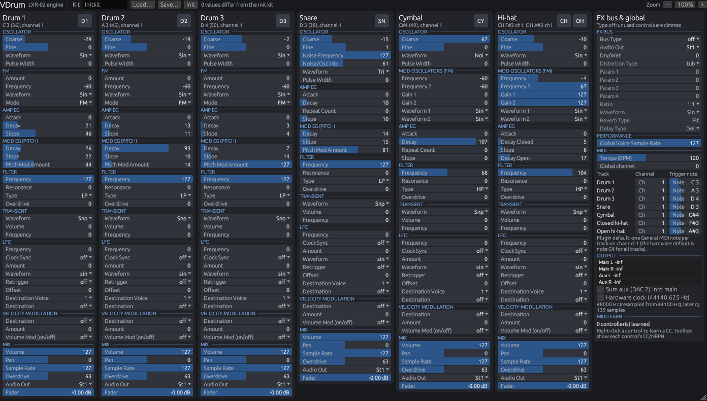

# VDrum plugin

CLAP, VST3 and standalone builds of VDrum, built on a port of the LXR-02 sound engine. Uses
[nih-plug](https://github.com/robbert-vdh/nih-plug), pinned to rev `de421011f41a6d10fc8c7a6084e4f4dee0143683`.
An AUv2 component and a macOS standalone app come from [clap-wrapper](../au/CMakeLists.txt).



The plugin talks to the sound engine through the `Engine` trait in `src/engine.rs`. It runs
`LxrEngine`, a wrapper around `lxr_core::Lxr` (the port of the LXR-02 engine, `ActiveEngine` in
`src/lib.rs`):

* `set_parameter` is the menu path of the contract (`menu_encoderChangeParameter`); `get_parameter`
  reads `activeParameters[]`. Out-of-range indices are ignored.
* `load_kit` / `save_kit` use the `.snd` format: 8 name bytes, then the 247 kit bytes
  (`preset_loadDrumsetSD` / `preset_saveDrumsetSD`).
* Faders: see *Voice faders* below.
* `StubEngine` (a test sound, not the LXR-02) is kept for tests of the plugin layer.
* **Safety net.** A panic inside the engine (an engine bug) must not unwind into the host, which
  would abort it. `LxrEngine` catches it, marks itself faulted, then renders silence and ignores
  input. `initialize()` replaces a faulted engine; the host parameters restore the kit. This path
  is not real-time safe (unwinding allocates), and it only runs after a bug.
* All MIDI from the host reaches the engine unfiltered, as on the hardware, except CCs that were
  MIDI-learned. A test feeds every status byte with many data values, including CC 0 (bank
  change) 64–127, through the plugin's event path. The engine does not fault.

### Performance

`cargo run --release -p vdrum --example engine_bench` retriggers all seven tracks every 8 ticks.
All voices are routed to the FX bus, which runs each FX type at 100 % wet. On the Linux x86_64 build
machine (generic `x86_64` target, no FMA, so `mul_add` is a software call) one `tick()` (64 frames)
took 23.5 µs on average, p99 39.8 µs. That is **1.6 % of one core** at 44.1 kHz, so no profiling
was needed. `new()` takes about 0.3 ms.

## Building

```sh
cargo xtask bundle vdrum --release
# target/bundled/VDrum.clap, target/bundled/VDrum.vst3, target/bundled/VDrum (standalone)

cargo xtask bundle vdrum --release --target x86_64-pc-windows-gnu    # Windows cross-build (mingw-w64)
cargo test -p vdrum -p lxr-params
```

On Linux the build needs the ALSA, JACK, X11/xcb, GL and Wayland client development packages:
`libasound2-dev libjack-jackd2-dev libgl-dev libx11-xcb-dev libxcb*-dev libxcursor-dev
libxkbcommon-dev libwayland-dev`. Wayland is required because the rfd file dialog depends on it.

The standalone takes `--backend {auto,jack,alsa,dummy}`, `--sample-rate` and `--period-size`
(run `--help` for the full list). It plays on the system's default output device. nih-plug's
CoreAudio/WASAPI/ALSA backend opens that device only at the exact rate and period size it is given,
and otherwise falls back to the silent dummy backend. So when `--sample-rate` is not passed,
`src/main.rs` passes the default output device's own rate (for example 44100 Hz on a Mac whose
output runs at 44.1 kHz). The period size stays 512 unless the device does not accept it, in which
case the nearest size it accepts is used. With `--backend jack` neither is changed. Pass
`--sample-rate 44100` to hear the engine output without resampling.

### AUv2 and standalone app (macOS)

```sh
cargo xtask bundle-universal vdrum --release
cmake -S au -B target/au -G Xcode -DVDRUM_CLAP=$PWD/target/bundled/VDrum.clap
cmake --build target/au --config Release
```

This uses clap-wrapper v0.9.1 (commit `eb8b1901`) and produces `VDrum.component` (type `aumu`,
manufacturer `VDrm`, subtype `VDr1`) and `VDrum.app`. Each embeds a copy of `VDrum.clap`. CI builds
both on GitHub's macOS runners and runs `auval` on the component; the release workflow ad-hoc signs
them. They are not notarized, so Gatekeeper asks for confirmation on first start (right-click, Open).

## Audio

* **Engine rate.** The engine renders 64-frame ticks at 44100 Hz. Its output (DAC 1 and DAC 2,
  i16) is converted to f32 by dividing by 32768.
* **Outputs.**
  * Main output: DAC 1.
  * Aux output: DAC 2.
  * The *Sum aux into main* switch (parameter ID `vdrum_sum_aux`) adds DAC 2 to the main output
    and silences the aux output.
  * A second layout ("Main only") has no aux port and always sums.
* **Sample rate.** At a 44100 Hz host rate the samples pass through unmodified. At any other rate
  they are resampled with rubato (`SincFixedIn`: 128-tap sinc, BlackmanHarris² window, cubic
  interpolation, oversampling 256). The resampler delay is included in the latency the plugin
  reports to the host.
* **Hardware clock** (parameter `vdrum_hardware_clock`, not automatable). The LXR-02's real sample
  clock is 44140.625 Hz, and the engine's coefficients use `REAL_FS` = 44140. When this switch is
  on, the engine runs at 44140.625 Hz and is always resampled to the host rate, so pitches and
  times match the hardware. It is off by default, which keeps 44100 Hz pass-through bit-exact.
  Both output stages are prepared in `initialize()`, so switching does not allocate. The output
  restarts and the plugin reports the new latency.
* **Floating point mode.**
  * The firmware runs the engine with flush-to-zero off (IEEE subnormals).
  * Plugin wrappers turn FTZ/DAZ on during `process()`.
  * `fp::IeeeGuard` clears them around every engine call (`tick`, `midi_byte`, `set_parameter`,
    `load_kit`, `get_parameter`, `new`) and restores the previous state afterwards:
    * x86: MXCSR bits 15 and 6.
    * aarch64: FPCR bit 24.
* **Bit-exactness test.** `src/real_engine_tests.rs` runs the scenario corpus (`tests/scenarios`)
  through the plugin's event scheduling and output path at 44100 Hz:
  * events are placed at jittered host sample positions;
  * five host buffer patterns are used, including 1, 7, 13, 947 and 4096 frames;
  * FTZ/DAZ is switched on, as a plugin wrapper would.
  
  The output, converted back to i16, matches the reference hashes of the shipped v1.71 firmware for
  all 299 scenarios without kit loads. `global_morph_no_target` and the 11 kit-load scenarios are
  skipped. A second test checks the plugin's MIDI defaults with all voices and the FX bus against
  `Lxr` called directly.
* **No allocations or locks on the audio thread.**
  * Fixed-capacity event queue and output FIFO.
  * Preallocated resampler buffers.
  * A lock-free `ArrayQueue` for commands from the GUI.
  * Kits travel inline.
  * This was checked with the real engine, in a debug build with the `assert_process_allocs`
    feature, in the standalone on Xvfb. Pads were played, parameters and faders dragged, and the
    init kit loaded while audio ran, with no allocation panics.

## Timing and latency

MIDI events and parameter changes are scheduled onto the 64-frame ticks:

* The output is delayed by a FIFO that starts with 64 frames of silence. At other rates it is about
  64 · rate / 44100 frames, plus the resampler delay.
* A tick runs when the FIFO is empty at host time `h`. Before it runs, every pending event with a
  host time below `h` is applied.
* As a result, an event inside a tick's time span is applied at the start of that tick. With the
  reported latency (64 samples at 44100 Hz), the host lines it up at most 63 engine frames early
  and never late.
* At 44100 Hz the output depends only on the absolute sample position, not on the host's buffer
  sizes (see the `pipeline` tests).

Host parameter values are polled once per host buffer (`SAMPLE_ACCURATE_AUTOMATION = false`). A
change is applied at the start of the next tick.

## MIDI

* **MIDI to the engine.** MIDI from the host goes to the engine as raw bytes through
  `Engine::midi_byte`: note on/off, program change, pitch bend and pressure. The firmware's MIDI
  parser decides what happens with them.
* **No preset CC mapping.** Control change messages (status `Bn`) from the host never reach the
  engine. A CC that is MIDI-learned changes its learned target (see *MIDI learn*); every other CC is
  dropped. The firmware's own CC/NRPN map (CC 2–127 to parameters 1–126, NRPN through CC 99/98/6,
  CC 0 bank change loading a kit) is therefore not used.
  * Reason: hosts pass on MIDI from every input. Through the firmware map, CCs from an unrelated
    controller change unrelated parameters; for example CC 6 (NRPN data entry) changes the last
    NRPN-addressed parameter.
* **Firmware behaviours worth knowing:**
  * A track triggers when the message is on its channel and the note matches. A track note of 0
    means any note.
  * **Default note map (plugin choice).** The firmware's default globals
    (`preset_loadDefaultGlobals`, which `preset_createGlobals` also writes to a new `glo.cfg`) put all
    seven tracks on channel 1 with note 48, so one note triggers every voice. Hardware with a
    `glo.cfg` behaves the same until the user changes it.
    * The plugin instead defaults to one General MIDI drum note per track, all on channel 1:
      Drum 1 = 36 (Bass Drum 1), Drum 2 = 45 (Low Tom), Drum 3 = 50 (High Tom), Snare = 38,
      Cymbal = 49 (Crash 1), closed hi-hat = 42, open hi-hat = 46.
    * It sets them after `Lxr::new()` through the firmware's own parameter path
      (`set_parameter(PAR_MIDI_NOTEx)`, which only writes `activeParameters`). These are also the
      host parameters' defaults.
    * The sound does not change: with a track note set, a matching note plays the voice at
      `SEQ_DEFAULT_NOTE`, as note 48 did before.
    * The engine itself keeps the firmware defaults, so the scenario reference hashes still hold.
    * Projects saved with older versions restore their stored notes.
  * The global channel defaults to 0, which means off.
  * Note-off is ignored. Program change on the global channel selects the next pattern.
* **MIDI learn.**
  * To learn: right-click a control, choose *MIDI learn*, then move a controller. The next CC on
    any channel is assigned.
  * Every parameter can be learned. That covers all engine parameters, the seven voice faders, and
    the *Sum aux* and *Hardware clock* switches.
  * A learned (channel, CC) pair is taken out of the stream and is not passed to the engine. Its
    7-bit value is scaled linearly onto the parameter's range: fader steps 0–99, and for the
    switches values of 64 and above mean on. The host parameter follows via the editor (same
    limitation as below).
  * The learn map is saved in the plugin state under the key `midi_learn` (parameter IDs, not
    indices).
  * The context menu can forget a learned CC; the MIDI learn section has *Forget all*.

## Parameters and GUI sync

* **Host parameters.** There are 286 engine parameters: 233 sound and 16 global from the firmware,
  and 37 for the open hi-hat voice (`lxr_core::vdrum::open_hat`). Firmware parameters have the ID
  of their enum name, lower case and without `PAR_` (for example `coarse1` or
  `midi_chan_global`); the open hi-hat's IDs end in `7` or `_oh` (`coarse7`, `wave1_oh`), and
  `hat_choke` is the closed-hat choke. The open hi-hat parameters come after the others, so the
  host slots of the firmware parameters did not move. `velod6_open` remains a host parameter but
  has no effect while the hi-hat is split. Groups follow voice and section (`Drum 1/Oscillator`, `FX/FX Bus`,
  `Global/MIDI`). Values show the firmware's edit-mode text; modulation targets are spelled out.
* **Voice faders.** The plugin adds seven parameters, `vdrum_fader_1` … `vdrum_fader_7`, for the
  hardware's volume faders (Drum 1–3, Snare, Cymbal, Hi-hat) and one for the open hi-hat. They are
  not part of the kit.
  * They have steps 0–99 and go through the hardware path, `adc_checkFaders` (`set_fader_adc`).
  * Step `s` reads ADC `36 + 41·s` (12 bit). Every step therefore clears the 40-count
    hysteresis, step 0 is silence, and step 99 is the top.
  * The top (0xFFF0, gain 0.99951) is the power-on value of the contract, and it is the default.
  * The gain is the square of the fader position, displayed in dB.
* **Not exposed.** `PAR_FX_REVERB_TYPE` has a single possible value (the firmware lists one reverb
  type), and a host parameter cannot have a zero-width range. It stays in the kit and the GUI shows
  it read-only. The 13 unused kit slots are also kept in the kit but not exposed.
* **Changes from MIDI and kit loads.** The audio thread compares the engine's values after every
  tick that applied MIDI, and after kit loads, then flags the values that changed. The editor
  copies them to the host parameters with begin/set/end gestures.
  * **nih-plug limitation:** only the GUI context can set host parameters. While the editor is
    closed, host parameters fall behind such changes until the editor is next opened.
  * The engine keeps its value whenever the host parameter is stale. Host values are only sent to
    the engine when the host changes them.
  * Saved state takes not-yet-copied values from the engine, so nothing is lost.

## State and kit files

* **Plugin state.** It holds:
  * the host parameters;
  * `kit`: the kit file bytes (8-byte name, 247 parameters and the open hi-hat block), hex encoded;
  * `globals`: the global settings by ID;
  * `midi_learn`;
  * `faders`: the voice fader steps;
  * `kit-library`: the kit library (the selected slot, then one line per filled slot with the kit
    file bytes hex encoded and the source file name, then the LXR-02 pattern names and kit numbers;
    absent when the library is empty);
  * `sequencer`: the sequencer's patterns and densities (JSON, only what differs from empty
    patterns; absent when all patterns are empty);
  * the editor size and zoom.
* **Restoring state.** The kit and the globals are authoritative. They are loaded into the engine
  in `initialize()`, and so are the sequencer patterns (a state without `sequencer` clears them).
* **Kit files.**
  * *Load…* reads the firmware's `.snd` format (`preset_loadDrumsetSD`) and VDrum kits. A firmware
    kit has no open hi-hat block; its open hi-hat is imported from the hi-hat.
  * *Save…* writes a VDrum kit: the firmware's 255 bytes (`preset_saveDrumsetSD`), then `VDX1`, a
    count byte and the 37 open hi-hat values (297 bytes). The firmware reads only the first 255.
  * *Save…* suggests the firmware's file name `NN-XXXXX.snd`.
  * *Init* loads the init kit.
  * *Load…*, *Save…* and *Init* deselect the library slot: the kit is no longer the slot's.
* **Kit library.** 64 kit slots (`00` to `63`, as in an LXR-02 project), saved with the plugin
  state (`plugin/src/library.rs`).
  * *Library ▾ → Import kits…* adds `.snd` files; *Import LXR-02 project folder…* adds the `.snd`
    files of a folder. A file named `NN-NAME.SND` goes into slot `NN`, any other file into the
    first empty slot.
  * Import skips init kits (the init kit's voice parameters; the FX bus is ignored because the
    LXR-02's `INITK` slots keep FX values from other kits) and kits already in the library (same
    name and sound). The status line reports the result, for example "Imported 16 kits (48 init
    kits skipped)".
  * An import that replaces filled slots opens the library panel and lists the slots it replaces,
    with *Import* and *Cancel*.
  * The library panel (*Library ▾ → Show library…*) lists the slots. Click loads a slot's kit;
    right-click saves the current kit there, renames, exports one `.snd`, clears, or moves the slot
    up or down.
  * ◀ and ▶ in the top bar load the previous and next filled slot.
  * Loading a slot selects it. *Save kit* (top bar) then writes the current kit into that slot
    only; *Save…* to a file stays separate.
  * The library is not a file on disk: it lives in the plugin state (host project or preset).
* **LXR-02 patterns and projects** (`plugin/src/lxr_files.rs`, from the firmware's
  `presetManager.c`).
  * *Library ▾ → Import patterns…* loads `.pat` files (`PatV03`, 3663 bytes) into the sequencer:
    `NN-NAME.PAT` goes to pattern `NN + 1` (the firmware numbers files from `00`), any other file
    to the first empty pattern. Empty patterns (no step on) are skipped. An import that replaces
    patterns with steps asks first.
  * *Import LXR-02 project folder…* imports the folder's kits and asks "Also import N patterns?
    This replaces patterns NN to NN in the sequencer." (*Import kits and patterns*, *Kits only*,
    *Cancel*).
  * A pattern file's steps, timing (flam, shift), parameter locks, main steps, track lengths and
    shuffle go to the sequencer as they are. Its name and kit number go to the library (the
    *Patterns* view of the library panel, where right-click renames or exports one `.pat`). VDrum
    does not change kits with patterns; the kit number is kept for export.
  * The firmware's step byte has an active bit (0x80) next to the main-step bits; playback uses
    only the main steps. Export sets the active bit from the main step, so a file where the two
    differ is not exported byte-identical (the DLC project's patterns differ in this bit only).
  * *Export LXR-02 project…* writes a folder an LXR-02 can load: `PRJ.NFO` (the current kit name),
    `GLO.CFG` (the 30 global parameters), and for each of the 64 slots `NN-NAME.SND` (255 bytes;
    an empty slot is the init kit, `NN-INITK.SND`), `NN-NAME.PAT` and an empty song `NN-EMPTY.SNG`.
    File names are upper case, as a FAT card shows them. LXR-02 project files already in the
    folder are replaced; other files stay.
  * Before writing, the panel lists what the LXR-02 cannot hold: the open hi-hat (only its decay
    is written, as the hi-hat's open decay `velod6_open`), track densities and Euclid settings (the
    steps they produced are written) and songs.
  * Checked against the uploaded DLC project folder (not in the repository): importing it gives 16
    kits and 16 patterns (48 init kits and 48 empty patterns skipped). Exporting that state gives
    byte-identical `.SND` files for the 16 kits and byte-identical songs. The init kit slots differ
    in 1 to 5 FX bytes (the firmware's `INITK` slots keep FX values from other kits; VDrum writes
    its init kit). `GLO.CFG` and `PRJ.NFO` come from the plugin's state, not from the imported
    folder, so they were not compared.

## GUI

* **Why egui.** The editor uses nih_plug_egui. Every parameter has to be on one screen (about 250
  controls generated from the `lxr-params` table), and immediate mode builds that from data without
  per-widget state or bindings. Vizia and iced would need a retained widget tree for every cell.
* **Layout.**
  * One card per voice, seven in all: Drum 1–3, Snare, Cymbal, Closed hi-hat, Open hi-hat. Each
    card holds all of that voice's sections:
    * Oscillator, FM (or the mod oscillators for the cymbal and hi-hat), Amp EG, Mod EG (pitch);
    * Filter, Transient, LFO, Velocity modulation;
    * Mix, including the fader.
  * Card headers show the trigger note and channel, with a trigger pad that lights when the track
    plays. The switch "closed hat chokes open hat" is one parameter shared by both hi-hats and
    appears on both hi-hat cards.
  * Labels are spelled out ("Pitch Mod Amount", "Destination Voice"). Values are shown as the
    LXR-02 display shows them in edit mode. The tooltip has the full name and, for modulation
    destinations, the spelled-out target.
  * Values that differ from their default (the init kit, or the plugin default for globals) have an
    amber stripe. The top bar counts them.
  * The default window is 1584 × 790 logical pixels (macOS points) and holds everything at 100 %
    without scrolling. With room for the menu bar, a host's plugin window header and the Dock, it
    fits the MacBook Pro 16" default resolution (1728 × 1117) at 100 % and the MacBook Air 13"
    (1470 × 956) and MacBook Pro 14" (1512 × 982) at 90 % zoom (or with horizontal scrolling). The
    `default_size_fits_everything` test lays the editor out headlessly and checks this.
  * States saved by the layout with one shared hi-hat card (layout version 2) at its default size
    (1392 × 790), and by the layout with a tab bar (version 4) at its default size (1584 × 836),
    open at the current default size; a size set by hand is kept.
  * A right-hand column holds:
    * the FX bus, with P1–P4 labelled for the current FX type from the firmware's FX page and
      controls not used by the type dimmed;
    * performance;
    * MIDI (BPM, global channel, channel and note per track);
    * output meters, the sum and hardware clock switches, and status.
  * The top bar has the kit name, Load/Save/Init, the library (◀ ▶, *Library ▾* and, while a slot
    is selected, *Save kit*), the count of changed values, status and zoom.
* **Controls.**
  * Drag a value bar to change it; hold Shift for fine steps.
  * Double-click resets to the default.
  * List parameters (waveforms, filter types, LFO and velocity targets, …) open a list on click.
    Mod-target lists offer the destination voice's range (`modTargetVoiceOffsets`).
  * Tooltips show the full name, value, range, default, learned CC and stable ID.
* **Window.** Resizable from the corner. Zoom with −/+ in 10 % steps from 50 % to 300 %
  (persisted); click the percentage to reset it to 100 %. Zoom scales the content and asks the host
  to scale the window by the same ratio; if the host refuses, the content is zoomed inside the
  unchanged window. The content scrolls if it does not fit. States saved by versions before the
  compact layout open at the new default size and 100 %, unless the window had been resized by
  hand.
* **Vendored GUI crates.** `third_party/egui-baseview` and `third_party/nih_plug_egui` are copies of
  the revisions nih-plug pins, with fixes for zoom and resizing (see `third_party/README.md`).

## Sequencer

The engine's ported LXR-02 sequencer plays the patterns (7 tracks, 64 patterns, 64 steps per
track). The plugin keeps a copy of the pattern data (`Shared::seq`, `vdrum_engine::seq::SeqData`);
pattern imports replace it and reload it into the engine (`Command::SeqReload`), so the audio
thread never waits for a lock. The plugin state saves the copy; `initialize()` loads it into the
engine. Engine writes go through `lxr_core::vdrum::seq`, which also updates the firmware's backup
copy of the playing pattern (`patternBackupBuffer`); without that, the firmware discards edits of
the playing pattern when the pattern changes.

* **Clock.** The sequencer follows the host transport. On start the plugin places every track at
  the host position (16th notes from the song start, modulo the track length) and then sends one
  pulse per 16th note at its sample position (`process()`), through the firmware's external clock
  input path (`seq_isSyncExternal` = 1, `trigger_clockReceived`). A jump of the host position
  (loop, locate) re-places the tracks. The rounded host tempo is passed to the engine for flams and
  shuffle. Stopping the transport stops the sequencer. The standalone app has no transport, so
  nothing plays there.
  * Pulses are applied at the start of the engine tick they fall into (up to 63 engine frames
    early, like MIDI). On the firmware's external clock path, odd 16th notes are delayed by the
    shuffle time even at shuffle 0, which ends one tick (1.45 ms) later.
* **Pattern changes** keep the kit. The firmware's default `PAR_PATTERN_MODE` 1 loads the
  pattern's kit slot from the engine's kit memory on every pattern change, which undid kit edits;
  the plugin sets it to 0 (it is not a host parameter).

## Validation (Linux, x86_64)

These results are for the real engine (`lxr-core`), from `cargo xtask bundle vdrum --release`.

* **clap-validator 0.3.2** on `VDrum.clap`: 18 passed, 0 failed, 3 skipped (preset discovery is
  not implemented).
  * Engine panics: none were logged, and the faulted safety net did not trigger.
* **pluginval 1.0.4** on `VDrum.vst3`: strictness 10, editor tests included, run on Xvfb: SUCCESS.
  * The log still shows two panics on the editor thread when windows close: an X11 `BadDrawable`
    from `unwrap()` in `baseview::gl::GlContext::swap_buffers` (baseview `src/gl/x11.rs:237`).
  * The host destroys the parent window while baseview's render thread draws one more frame.
  * The panic ends only that GUI thread, and pluginval passes.
  * A fix needs a change in baseview: handle the error in `swap_buffers`, or stop rendering
    before the parent window goes away. It is not in the plugin's code.
* **Standalone.** Ran with `--backend dummy` at 44100 and 48000 Hz on Xvfb. Checked by driving
  the GUI with xdotool: pads trigger notes (meters move), dragging changes values, and the MIDI
  learn menu opens.
* **Windows.** The `x86_64-pc-windows-gnu` cross-build produces `VDrum.clap`, `VDrum.vst3` and
  `VDrum.exe`. They have not been run.
* **Software GL caveat.** baseview asks for an sRGB-capable GLX framebuffer, and Xvfb's software
  GLX has none. GUI runs on Xvfb therefore used a small `LD_PRELOAD` shim that drops that one
  attribute. Real X servers with GPU drivers provide such configs.
